

# Human-Computer Interaction

**BIL-429 İnsan-Bilgisayar Etkileşimi. Undergraduate elective course, Department of Computer Engineering, Süleyman Demirel University, Isparta, Türkiye**

*A 14-week undergraduate course with lecture pages, interface clinics, 3D games and experiments in interactive labs, Colab notebooks that analyse the students' own interaction data, and a Python track for beginners*

         

**This course is updated in line with current developments in the field. First version: November 2026.**

**Prof. Dr. Utku Kose**

Full Professor, Department of Computer Engineering, Süleyman Demirel University, Isparta, Türkiye  
Founding Director, AI Application and Research Center (YAZEM), Süleyman Demirel University  
Head of the Computer Science Division, Department of Computer Engineering, Süleyman Demirel University  
Additional affiliations: University of North Dakota (USA), Universidad Panamericana (Mexico City, Mexico), Vel Tech University (Chennai, India)  
IEEE Senior Member, ACM Professional Member

[ORCID 0000-0002-9652-6415](https://orcid.org/0000-0002-9652-6415) | [utkukose.com](https://www.utkukose.com) | [github.com/utkukose](https://github.com/utkukose)

[utkukose@sdu.edu.tr](mailto:utkukose@sdu.edu.tr) | [utku.kose@und.edu](mailto:utku.kose@und.edu) | [ukose@up.edu.mx](mailto:ukose@up.edu.mx) | [utkukose@gmail.com](mailto:utkukose@gmail.com)

## About the course

Human-computer interaction (HCI) studies how people use interactive computing systems and how such systems should be designed, evaluated and built for human use [1]. This repository holds the open materials of the undergraduate course Human-Computer Interaction (İnsan-Bilgisayar Etkileşimi) of the Department of Computer Engineering at Süleyman Demirel University. Over fourteen weeks, the course leads from the interaction loop, user-centred design and usability [2, 3, 4] to the abilities of the human. These are perception and the psychological effects of colour, attention, memory and movement [5]. It then covers design principles, user research, prototyping, visual design and the statistics of usability testing [6]. It continues with accessibility [7], mobile and multimodal interaction and three-dimensional (3D) user interfaces [8]. The last two weeks turn to interaction with artificial intelligence (AI): Trust, reliance, explanations, conversation, dark patterns and the ethics of design [9].

Interaction is learned best by interacting. Every week therefore holds 3D games and experiments in its interactive lab, such as two hospital kiosks to race on, a corridor of doors and a cooktop in Week 1. Their results feed the Colab notebook, where Python turns the students' own trials into the measures of the lecture. Every week also holds an *interface clinic*, with screens of a running project shown before and after a redesign, and questions for discussing the interaction between people and computers. A short closing section connects each week to human-AI interaction. The [syllabus](SYLLABUS.md) sets out the course information, the learning outcomes, the weekly plan, the assessment and the course policies. The sections below explain how the materials of a week fit together and where to find them.

## Use in other courses

These materials were prepared for the undergraduate course Human-Computer Interaction at Süleyman Demirel University. They are openly available: Anyone may use and adapt them in courses of related content, at any level, with attribution as described in the license section. Instructors who adopt them are welcome to report errors or suggest improvements through the issues of this repository.

## A look inside

Every lecture page holds an interactive scene and an interface clinic, and every interactive lab holds games and experiments in three dimensions that record the student's own interaction. A click on a picture opens its page.

<table><tr><td width="33%" valign="top"><a href="https://utkukose.github.io/human-computer-interaction-NB-lecture/weeks/week-01/lecture.html#scene">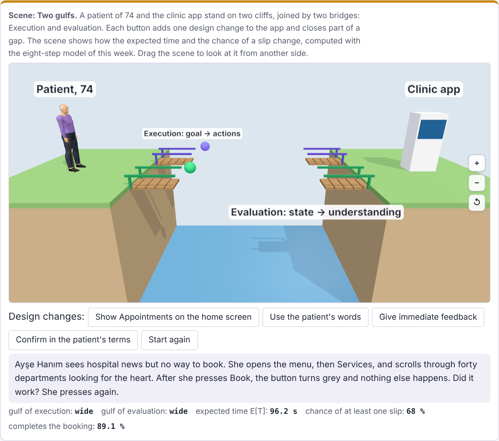</a> Week 1: The scene Two gulfs</td><td width="33%" valign="top"><a href="https://utkukose.github.io/human-computer-interaction-NB-lecture/weeks/week-02/lab.html#pc">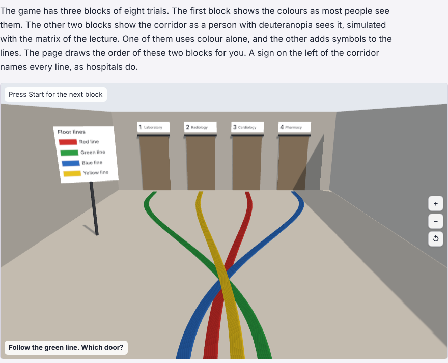</a> Week 2: Follow the line</td><td width="33%" valign="top"><a href="https://utkukose.github.io/human-computer-interaction-NB-lecture/weeks/week-03/lecture.html#scene">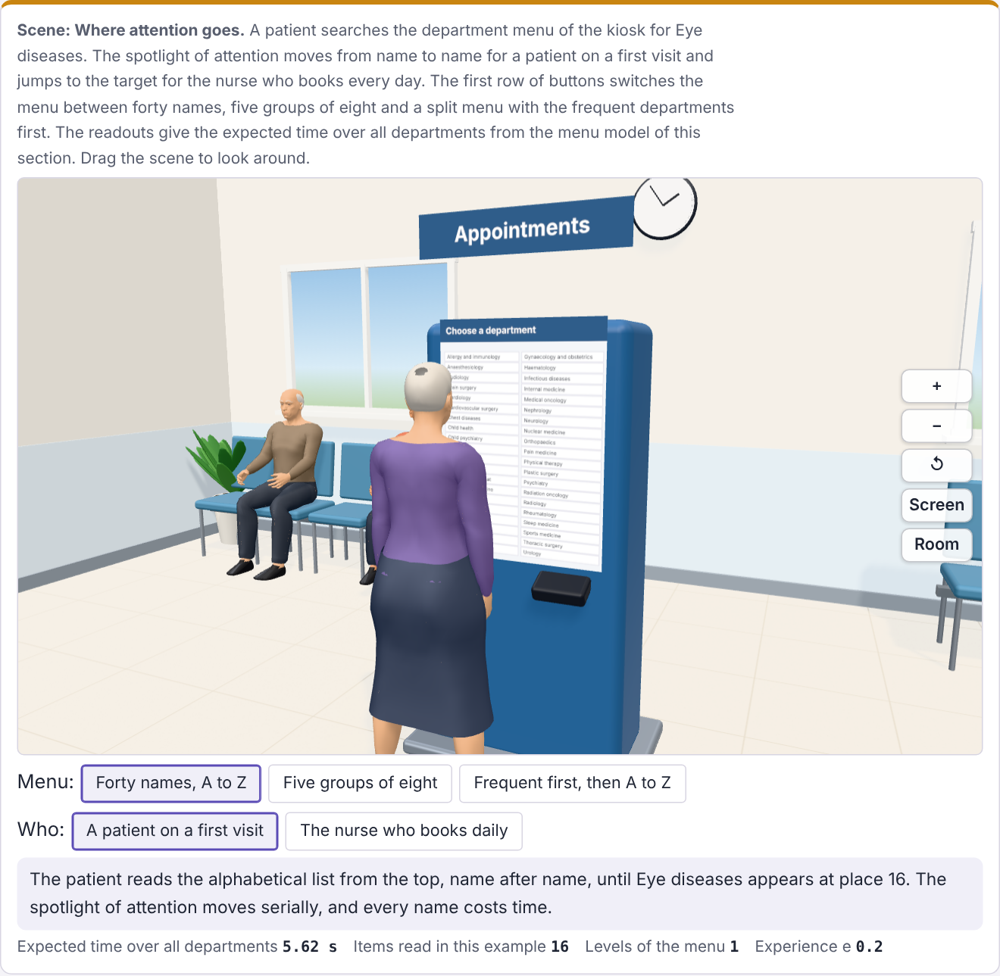</a> Week 3: The scene Where attention goes</td></tr><tr><td width="33%" valign="top"><a href="https://utkukose.github.io/human-computer-interaction-NB-lecture/weeks/week-04/lab.html#pc">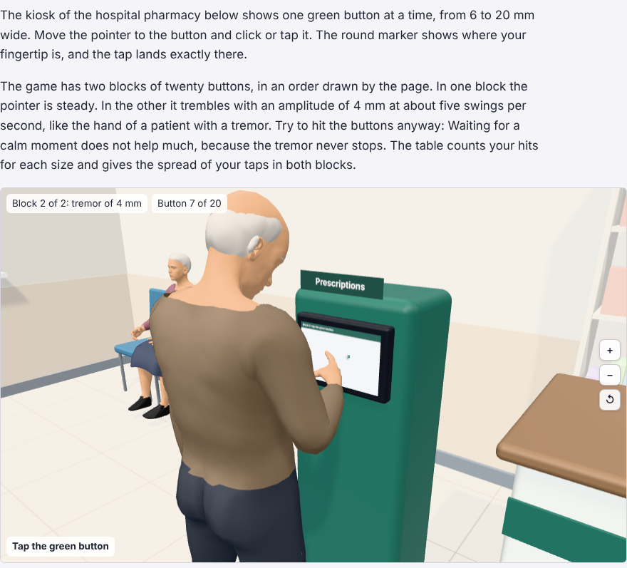</a> Week 4: Tremor at the kiosk</td><td width="33%" valign="top"><a href="https://utkukose.github.io/human-computer-interaction-NB-lecture/weeks/week-05/lab.html#pc">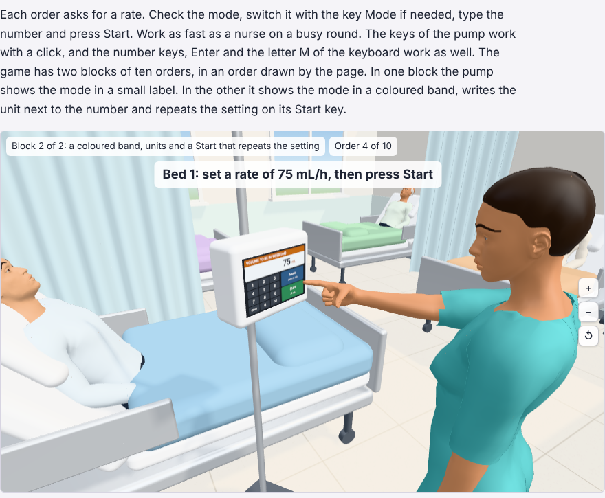</a> Week 5: The infusion pump</td><td width="33%" valign="top"><a href="https://utkukose.github.io/human-computer-interaction-NB-lecture/weeks/week-06/lab.html#pa">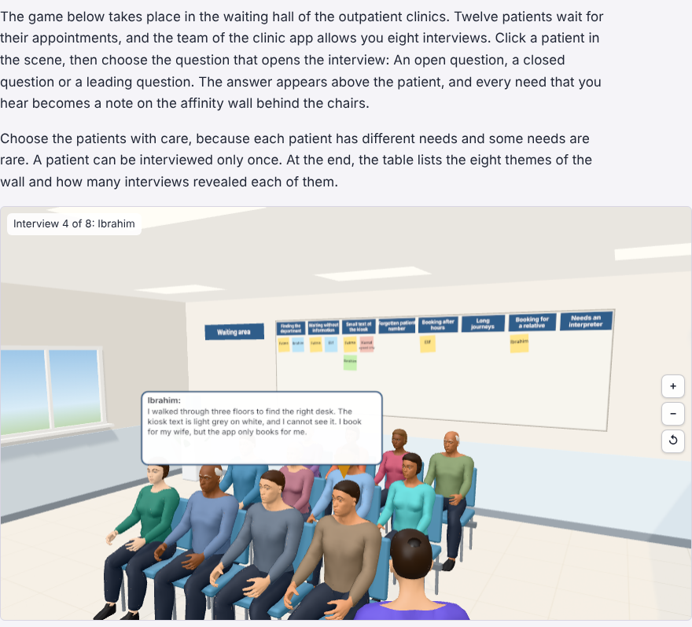</a> Week 6: Interviews in the waiting room</td></tr><tr><td width="33%" valign="top"><a href="https://utkukose.github.io/human-computer-interaction-NB-lecture/weeks/week-07/lecture.html#scene">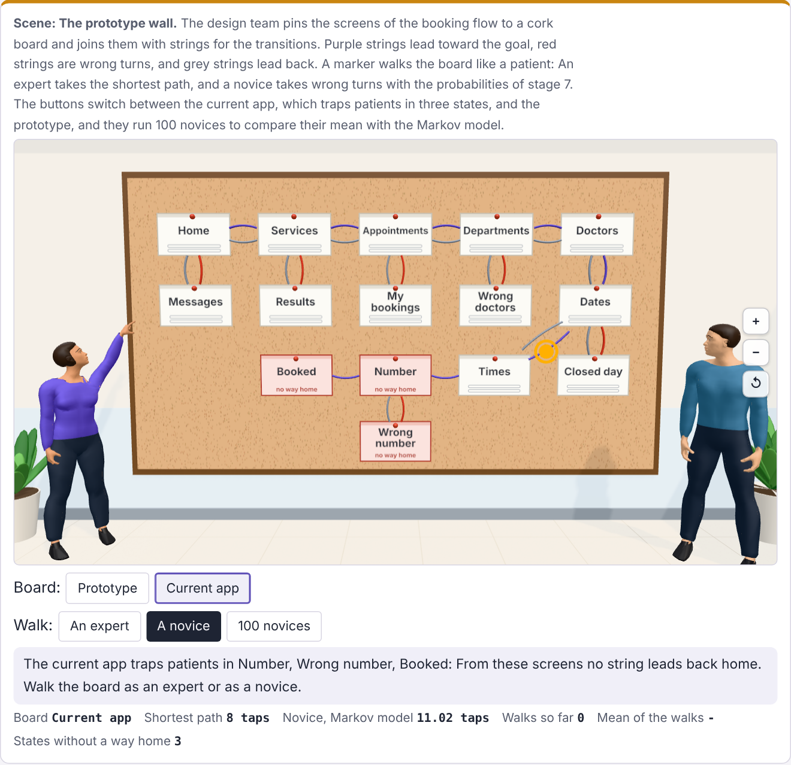</a> Week 7: The scene The prototype wall</td><td width="33%" valign="top"><a href="https://utkukose.github.io/human-computer-interaction-NB-lecture/weeks/week-08/lecture.html#scene">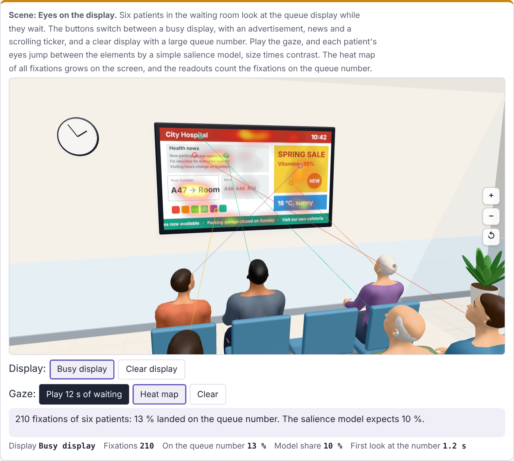</a> Week 8: The scene Eyes on the display</td><td width="33%" valign="top"><a href="https://utkukose.github.io/human-computer-interaction-NB-lecture/weeks/week-09/lab.html#pa">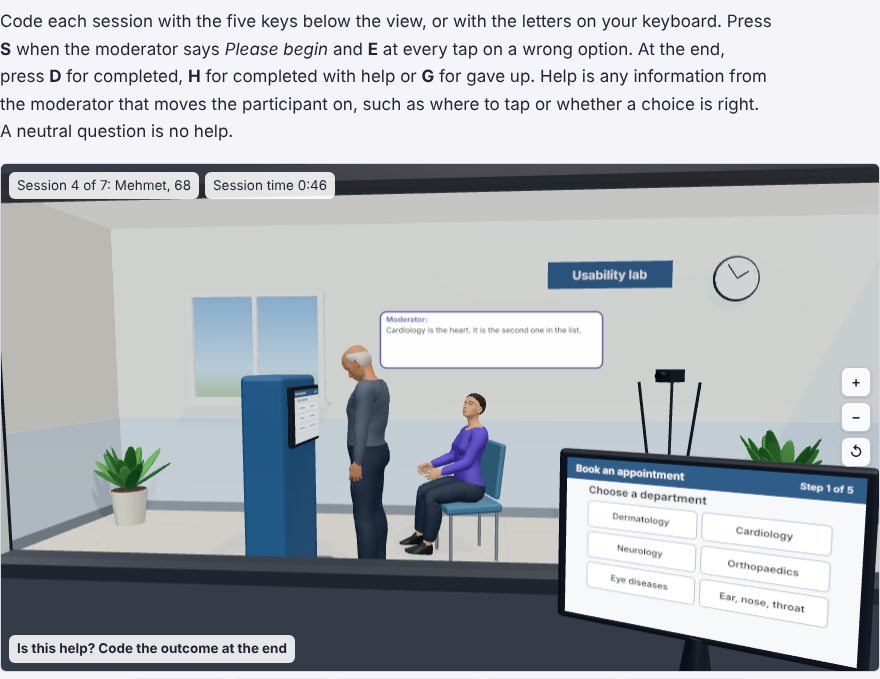</a> Week 9: The observation room</td></tr><tr><td width="33%" valign="top"><a href="https://utkukose.github.io/human-computer-interaction-NB-lecture/weeks/week-10/lab.html#pa">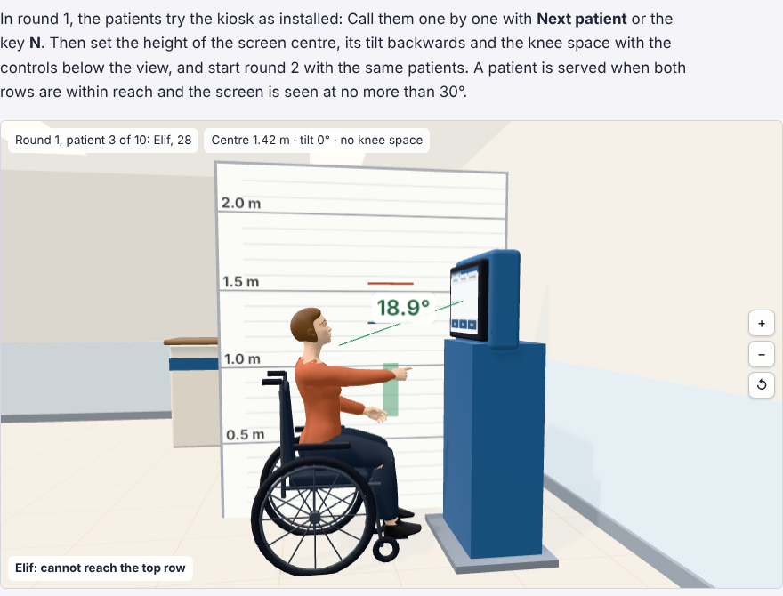</a> Week 10: The kiosk for everyone</td><td width="33%" valign="top"><a href="https://utkukose.github.io/human-computer-interaction-NB-lecture/weeks/week-11/lecture.html#scene">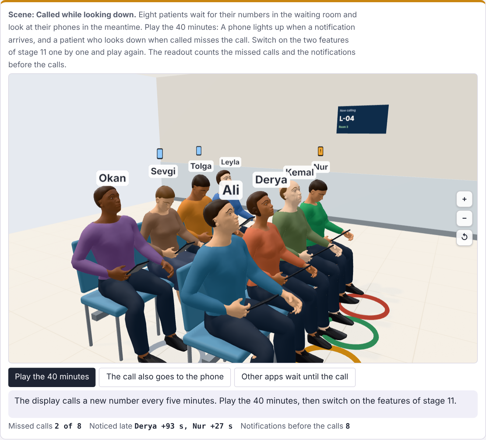</a> Week 11: The scene Called while looking down</td><td width="33%" valign="top"><a href="https://utkukose.github.io/human-computer-interaction-NB-lecture/weeks/week-12/lab.html#pd">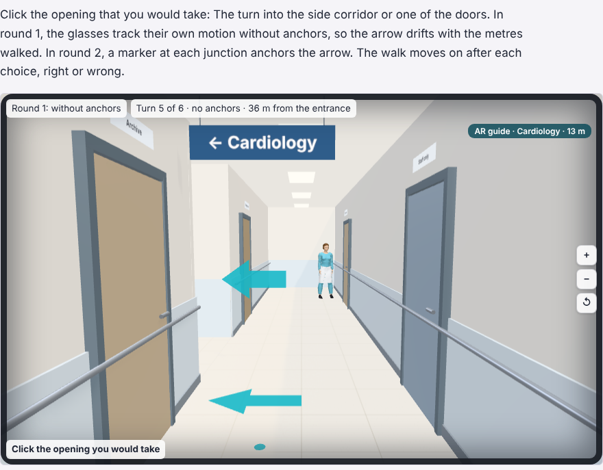</a> Week 12: Arrows in the corridor</td></tr><tr><td width="33%" valign="top"><a href="https://utkukose.github.io/human-computer-interaction-NB-lecture/weeks/week-13/lab.html#pa">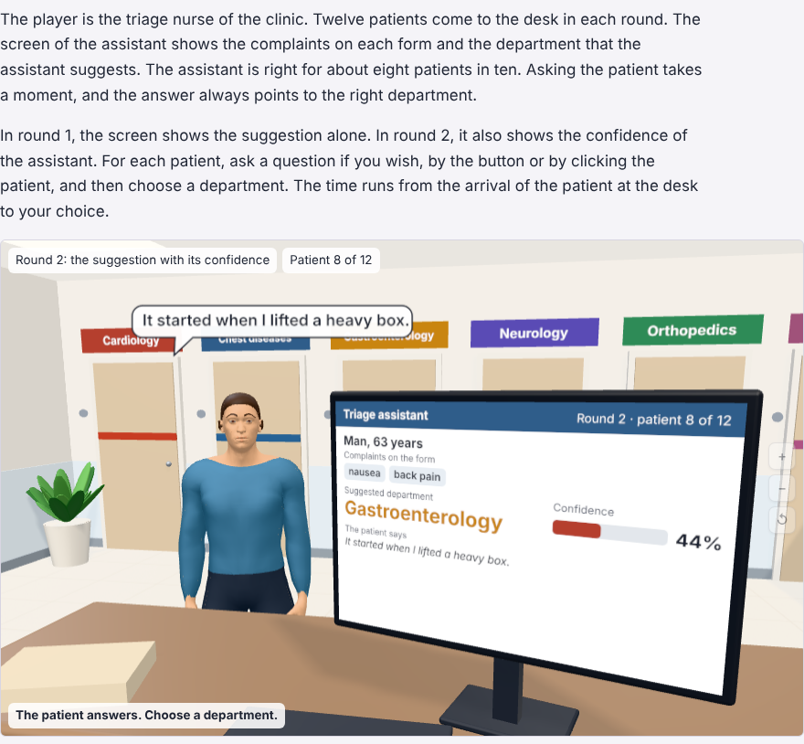</a> Week 13: The triage desk</td><td width="33%" valign="top"><a href="https://utkukose.github.io/human-computer-interaction-NB-lecture/weeks/week-14/lab.html#pd">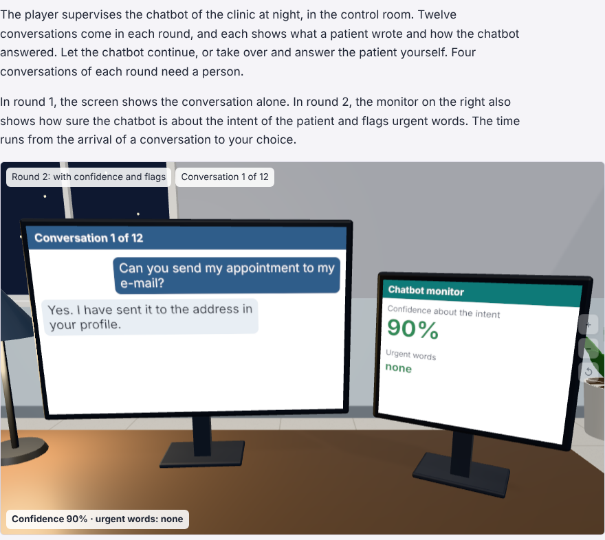</a> Week 14: The night supervisor</td></tr></table>

## Who the course is for

The course is written for third- and fourth-year undergraduate students of computer engineering and related programmes, and for self-learners anywhere. Programming experience in any language helps, but it is not required. The start-here Colab notebook and the fourteen Python steps teach the Python needed for the course through the project itself. Students who already program in Python can treat the Python steps as a quick review and spend the time on the exercises, the application challenges and the research assignments.

## Course learning outcomes

On completion, students are expected to:

1. Explain the interaction loop, user-centred and system-centred design, usability and user experience, and measure usability with standard measures and questionnaires.
2. Relate interface design to perception, including the psychological effects of colour, and to attention, memory and movement, and predict performance with Fitts' law and the keystroke-level model.
3. Apply design principles and usability heuristics to evaluate interfaces and to rank usability problems.
4. Carry out user research, build personas and task analyses, and prototype interaction flows.
5. Plan and analyse usability tests with questionnaires, confidence intervals and controlled comparisons.
6. Design for accessibility and inclusion, and for mobile, multimodal and three-dimensional interaction.
7. Design and evaluate interaction with AI systems, including mental models, trust, reliance, explanations, conversation and ethics.
8. Write and run Python programs in Google Colab that simulate users, analyse interaction data and build small interactive prototypes.

## How the course works

Each week has an overview page in its folder, which links to four materials with distinct roles. The lecture page explains the concepts with formulas, worked examples, an interactive scene, animations, an interface clinic, knowledge checks and review cards. The Colab notebook holds the Python step of the week and the hands-on work on the clinic app, with exercises that give immediate feedback and reference solutions in collapsed cells. Each of its sections links back to the part of the lecture that it applies, and each can be started on its own. The interactive lab turns the ideas into practice. It holds 3D games and experiments that record the student's own interaction, step-by-step calculators for the worked examples, a simulation and a calculation by hand. The results of the games can be copied into the Colab notebook, where they become the data of the week. The interactive lab closes with a self-assessment and an exportable learning log. The PDF lecture notes collect the Python step and the lecture in one printable file.

The course works in two modes. In a synchronous delivery, each week runs as one session of about three hours, following the live session plan on its overview page. In asynchronous study, the same materials are used along the study path on the overview page, which lists every activity with a suggested time. Earlier work on software support for self-learning in computer engineering courses informed this structure [10].

Students who have never programmed start with [`start-here/`](start-here/README.md) and then follow the weeks in order. The course site at <https://utkukose.github.io/human-computer-interaction-NB-lecture/> links every page and keeps track of the completed knowledge checks in the browser.

## The clinic app, the project of the course, week by week

One project runs through the whole course: The appointment app of a city hospital, called *the clinic app*, with a kiosk in the lobby for check-in. Patients book, change and cancel appointments with it. The app, the hospital and its users are invented, so that every number can be computed and checked. Each week first teaches its methods on small examples and then takes the clinic app one stage further, in a lecture section titled *The clinic app, stage N*. The figure shows the fourteen stages, and the table links each published stage to its section.

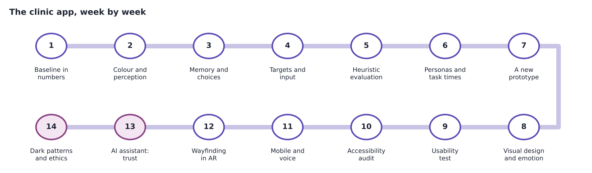

| Week | Stage of the project | Methods | Result |
|---|---|---|---|
| [Week 1](https://utkukose.github.io/human-computer-interaction-NB-lecture/weeks/week-01/lecture.html#the-clinic-app-stage-1) | A baseline of the booking flow in numbers | The interaction loop, user-centred design, usability measures with the System Usability Scale, a chain-of-steps model with a simulation | $P_0 = 0.318$, $\mathrm{E}[T] = 96.2$ s and $P_c = 0.891$; step 2, finding the booking, loses the most patients |
| [Week 2](https://utkukose.github.io/human-computer-interaction-NB-lecture/weeks/week-02/lecture.html#the-clinic-app-stage-2) | An audit of colours, contrast and text size, and the colour mood of the waiting room | Visual angle, contrast ratio, colour spaces, simulated colour vision deficiency, colour and emotion ratings | 5 of 9 colour pairs fail level AA; the kiosk prompts reach only 0.191°; the status colours fall from $\Delta E^*_{ab} = 120.3$ to 21.6 with deuteranopia; a pale wall predicts a calmer waiting room |
| [Week 3](https://utkukose.github.io/human-computer-interaction-NB-lecture/weeks/week-03/lecture.html#the-clinic-app-stage-3) | Menus and forms that need less memory | Visual search, Hick-Hyman law, working memory, defaults, menu model | A split menu cuts the choice of a department to 3.55 s for patients and 1.74 s for the nurse; typed from memory, the patient number is right for 0.4 percent; the text default misfits 120 patients a day |
| [Week 4](https://utkukose.github.io/human-computer-interaction-NB-lecture/weeks/week-04/lecture.html#the-clinic-app-stage-4) | Targets that fit fingers, tremor and the kiosk | Fitts' law, effective width and throughput, touch with tremor, the steering law | Chips of 12 mm instead of 7 mm lift the hit rate of a patient with tremor from 0.365 to 0.730; a hit rate of 95 percent needs 18.4 mm with tremor; a button of 25 mm replaces the slide to confirm |
| [Week 5](https://utkukose.github.io/human-computer-interaction-NB-lecture/weeks/week-05/lecture.html#the-clinic-app-stage-5) | A heuristic evaluation with a ranked list of problems | Heuristic evaluation, the discovery model with the adjustment of Lewis, slips and mode errors, defences in layers | Five evaluators found 16 problems, about three quarters of an estimated 21; nine evaluators would find 90 percent; Cancel next to Confirm, with a mean severity of 3.8, comes first |
| [Week 6](https://utkukose.github.io/human-computer-interaction-NB-lecture/weeks/week-06/lecture.html#the-clinic-app-stage-6) | Personas, task analysis and predicted task times | Interviews and saturation, personas from data with k-means, hierarchical task analysis, the keystroke-level model | Three personas from k-means with $W = 5.31$; the redesigned kiosk saves 11.50 s per booking, 479.2 hours a year, and Hasan gains the most with 13.87 s; an average booking takes 63.5 s |
| [Week 7](https://utkukose.github.io/human-computer-interaction-NB-lecture/weeks/week-07/lecture.html#the-clinic-app-stage-7) | A prototype of the new booking flow | Prototypes and fidelity, breadth and depth of menu trees, information scent, card sorting, state machines with Markov models | Five categories and eight departments take 4.07 s instead of 7.00 s; the prototype needs 6 taps, 6.55 for a novice instead of 11.02, and traps nobody, while the current app traps patients in three states |
| [Week 8](https://utkukose.github.io/human-computer-interaction-NB-lecture/weeks/week-08/lecture.html#the-clinic-app-stage-8) | Redesigned screens with a clear visual hierarchy | Gestalt grouping and the pure distance law, balance and alignment, heat maps, colourfulness and complexity, the peak-end rule | The summary screen reaches a balance of 0.866 instead of 0.453, with 24 distinct edges instead of 45 and less than half the colourfulness; with the same 4.7 s of waiting, the peak-end value falls from 3.00 s to 1.70 s |
| [Week 9](https://utkukose.github.io/human-computer-interaction-NB-lecture/weeks/week-09/lecture.html#the-clinic-app-stage-9) | A usability test of both designs | Think-aloud sessions and Cohen's kappa, adjusted Wald intervals, geometric means and Welch's test, recruiting and sample sizes, A/B tests and peeking | The redesign is faster, 51.3 s against 83.5 s, and better liked, a SUS score of 75.8 against 53.8; its completion rate of 11 of 13 against 8 of 13 is not yet certain (p = 0.193), and 57 patients per design would settle it |
| [Week 10](https://utkukose.github.io/human-computer-interaction-NB-lecture/weeks/week-10/lecture.html#the-clinic-app-stage-10) | An accessibility audit of the app and the kiosk | Exclusion with overlapping limitations, WCAG 2.2, reach and sight lines, readability in English and Turkish, the navigation cost of a screen reader | The current app fails 18 of the 55 criteria of levels A and AA, and tools find only 7 of them; the kiosk at 1.13 m with knee space serves 0.989 of the patients instead of 0.867; the plain confirmation falls from grade 13.08 to 3.21, and a screen-reader user needs 15 presses instead of 43 |
| [Week 11](https://utkukose.github.io/human-computer-interaction-NB-lecture/weeks/week-11/lecture.html#the-clinic-app-stage-11) | The app on the phone, with voice | The functional area of the thumb, the \$1 gesture recognizer, text entry speed and errors, the word error rate with a read-back, notifications as random arrivals, and reminders | The main actions move within reach of 0.987 of the thumbs instead of 0.096; two taps replace 19.6 s of typing; a read-back cuts wrong voice bookings from 0.302 to 0.030; calls sent to the phone remove the missed calls, and reminders raise attendance from 0.82 to 0.871 |
| [Week 12](https://utkukose.github.io/human-computer-interaction-NB-lecture/weeks/week-12/lecture.html#the-clinic-app-stage-12) | Wayfinding in the hospital with augmented reality | Selection with a ray and a virtual hand, travel by steering and teleporting, presence and the Simulator Sickness Questionnaire, registration and drift in augmented reality | A snapping ray lifts the signs hit at the first click from 0.822 to 0.987; teleports take 10.0 s instead of 20.1 s without smooth motion, and the simulated pilot scores 14.49 instead of 43.17 for sickness; anchors cut the expected wrong turns from 0.842 to 0.007 per trip |
| [Week 13](https://utkukose.github.io/human-computer-interaction-NB-lecture/weeks/week-13/lecture.html#the-clinic-app-stage-13) | An AI assistant that suggests a department | Reliance with a threshold of confidence, calibration with the expected calibration error, the Brier score and temperature scaling, contrastive explanations, and a model of trust over time | At a threshold of 0.8, the assistant and a nurse together choose the right department for 0.921 of the patients, against 0.802 for the assistant alone; temperature scaling lowers the expected calibration error of a sharpened confidence from 0.102 to 0.0265; a display of the robots' success cuts the expected minutes of 18 deliveries from 118 to 106 |
| [Week 14](https://utkukose.github.io/human-computer-interaction-NB-lecture/weeks/week-14/lecture.html#the-clinic-app-stage-14) | A conversational booking assistant and a review of dark patterns | A dialogue manager as a tested finite-state machine, confirmations below a threshold of confidence, the evaluation of dialogues by task success and costs, the keystroke-level model of dark patterns, consent under the General Data Protection Regulation and a rule for handing over to a person | Asking back below a confidence of 0.8 keeps 0.946 of the bookings right with 4.526 turns, against 0.729 without asking back; fair screens cut the cancellation from 18.55 s to 5.3 s and avoid 225 consents to marketing in 1,000; the handover rule finds all 8 conversations that need a person, with a precision of 0.727 |

In the final project, each student takes an interface of their own choice along the same stages. These are a baseline, an evaluation, a redesign, a test and an AI feature measured for reliance.

## Weekly schedule

| Week | Topic | Week overview | Lecture page | Interactive lab | Colab notebook | PDF lecture notes |
|---|---|---|---|---|---|---|
| 1 | Foundations: The Interaction Loop, User-Centred Design and Usability | [Week overview](weeks/week-01/README.md) | [Lecture page](https://utkukose.github.io/human-computer-interaction-NB-lecture/weeks/week-01/lecture.html) | [Interactive lab](https://utkukose.github.io/human-computer-interaction-NB-lecture/weeks/week-01/lab.html) |  | [PDF notes](weeks/week-01/Week01_Lecture_Notes.pdf) |
| 2 | The Human I: Perception, Colour and Its Psychological Effects | [Week overview](weeks/week-02/README.md) | [Lecture page](https://utkukose.github.io/human-computer-interaction-NB-lecture/weeks/week-02/lecture.html) | [Interactive lab](https://utkukose.github.io/human-computer-interaction-NB-lecture/weeks/week-02/lab.html) |  | [PDF notes](weeks/week-02/Week02_Lecture_Notes.pdf) |
| 3 | The Human II: Attention, Memory and Decisions | [Week overview](weeks/week-03/README.md) | [Lecture page](https://utkukose.github.io/human-computer-interaction-NB-lecture/weeks/week-03/lecture.html) | [Interactive lab](https://utkukose.github.io/human-computer-interaction-NB-lecture/weeks/week-03/lab.html) |  | [PDF notes](weeks/week-03/Week03_Lecture_Notes.pdf) |
| 4 | The Human III: Movement, Pointing and Input | [Week overview](weeks/week-04/README.md) | [Lecture page](https://utkukose.github.io/human-computer-interaction-NB-lecture/weeks/week-04/lecture.html) | [Interactive lab](https://utkukose.github.io/human-computer-interaction-NB-lecture/weeks/week-04/lab.html) |  | [PDF notes](weeks/week-04/Week04_Lecture_Notes.pdf) |
| 5 | Design Principles, Heuristics and Human Error | [Week overview](weeks/week-05/README.md) | [Lecture page](https://utkukose.github.io/human-computer-interaction-NB-lecture/weeks/week-05/lecture.html) | [Interactive lab](https://utkukose.github.io/human-computer-interaction-NB-lecture/weeks/week-05/lab.html) |  | [PDF notes](weeks/week-05/Week05_Lecture_Notes.pdf) |
| 6 | User-Centred Design in Practice: Interviews, Personas and Tasks | [Week overview](weeks/week-06/README.md) | [Lecture page](https://utkukose.github.io/human-computer-interaction-NB-lecture/weeks/week-06/lecture.html) | [Interactive lab](https://utkukose.github.io/human-computer-interaction-NB-lecture/weeks/week-06/lab.html) |  | [PDF notes](weeks/week-06/Week06_Lecture_Notes.pdf) |
| 7 | Prototypes and Navigation: Menu Trees, Scent and State Machines | [Week overview](weeks/week-07/README.md) | [Lecture page](https://utkukose.github.io/human-computer-interaction-NB-lecture/weeks/week-07/lecture.html) | [Interactive lab](https://utkukose.github.io/human-computer-interaction-NB-lecture/weeks/week-07/lab.html) |  | [PDF notes](weeks/week-07/Week07_Lecture_Notes.pdf) |
| 8 | Visual Design and Emotion: Grouping, Layout, First and Last Impressions | [Week overview](weeks/week-08/README.md) | [Lecture page](https://utkukose.github.io/human-computer-interaction-NB-lecture/weeks/week-08/lecture.html) | [Interactive lab](https://utkukose.github.io/human-computer-interaction-NB-lecture/weeks/week-08/lab.html) |  | [PDF notes](weeks/week-08/Week08_Lecture_Notes.pdf) |
| 9 | Usability Testing: Observing People and Measuring with Confidence | [Week overview](weeks/week-09/README.md) | [Lecture page](https://utkukose.github.io/human-computer-interaction-NB-lecture/weeks/week-09/lecture.html) | [Interactive lab](https://utkukose.github.io/human-computer-interaction-NB-lecture/weeks/week-09/lab.html) |  | [PDF notes](weeks/week-09/Week09_Lecture_Notes.pdf) |
| 10 | Accessibility and Inclusive Design | [Week overview](weeks/week-10/README.md) | [Lecture page](https://utkukose.github.io/human-computer-interaction-NB-lecture/weeks/week-10/lecture.html) | [Interactive lab](https://utkukose.github.io/human-computer-interaction-NB-lecture/weeks/week-10/lab.html) |  | [PDF notes](weeks/week-10/Week10_Lecture_Notes.pdf) |
| 11 | Mobile, Multimodal and Ubiquitous Interaction | [Week overview](weeks/week-11/README.md) | [Lecture page](https://utkukose.github.io/human-computer-interaction-NB-lecture/weeks/week-11/lecture.html) | [Interactive lab](https://utkukose.github.io/human-computer-interaction-NB-lecture/weeks/week-11/lab.html) |  | [PDF notes](weeks/week-11/Week11_Lecture_Notes.pdf) |
| 12 | 3D User Interfaces, Virtual and Augmented Reality | [Week overview](weeks/week-12/README.md) | [Lecture page](https://utkukose.github.io/human-computer-interaction-NB-lecture/weeks/week-12/lecture.html) | [Interactive lab](https://utkukose.github.io/human-computer-interaction-NB-lecture/weeks/week-12/lab.html) |  | [PDF notes](weeks/week-12/Week12_Lecture_Notes.pdf) |
| 13 | Human-AI Interaction I: Trust, Reliance and Explanations | [Week overview](weeks/week-13/README.md) | [Lecture page](https://utkukose.github.io/human-computer-interaction-NB-lecture/weeks/week-13/lecture.html) | [Interactive lab](https://utkukose.github.io/human-computer-interaction-NB-lecture/weeks/week-13/lab.html) |  | [PDF notes](weeks/week-13/Week13_Lecture_Notes.pdf) |
| 14 | Human-AI Interaction II: Conversational Interfaces, Dark Patterns and Ethics | [Week overview](weeks/week-14/README.md) | [Lecture page](https://utkukose.github.io/human-computer-interaction-NB-lecture/weeks/week-14/lecture.html) | [Interactive lab](https://utkukose.github.io/human-computer-interaction-NB-lecture/weeks/week-14/lab.html) |  | [PDF notes](weeks/week-14/Week14_Lecture_Notes.pdf) |

## Python for non-programmers

Python is taught step by step alongside the content of the course, always through the tool that the clinic app of the week needs [11]. Every week has a Python step in its Colab notebook, right after the setup section. It explains one group of fundamentals with runnable cells and closes with a quick check and three exercises. The fourteen steps start with values, variables, lists and decisions in Week 1. They continue with NumPy arrays, random numbers, fitted lines and matrices [12, 13, 14]. The middle weeks add distances and groups, classes and events, images as arrays and statistical tests with SciPy [15]. The last steps cover text with regular expressions, points and paths, vectors in three dimensions, probabilities and organised, tested code.

The full sequence is described in [`PYTHON_PATH.md`](PYTHON_PATH.md).

## Assessment and submission

Assessment rests on two projects, each a coding application with a short technical report. The midterm project at the end of Week 7 studies an interface of the student's choice with the methods of Weeks 1 to 7. It combines a baseline model, a heuristic evaluation, personas, predicted task times and a redesign proposal. The final project at the end of Week 14 designs, prototypes and evaluates an interface with an AI feature, including a usability test, an accessibility audit and measures of reliance. The midterm component counts 40 percent of the course grade and the final project 60 percent. Each week also offers an optional task, an optional research and report assignment and a self-assessment in the interactive lab. The optional work carries no separate weight. It is combined with the midterm component, and the instructor may take it into account as a discretionary adjustment. During an active semester, the deadlines are announced by the instructor, and the optional work can be sent to utkukose@sdu.edu.tr or utkukose@gmail.com.

| Component | Timing | Format | Weight | Page |
|---|---|---|---|---|
| Weekly task and learning log (optional) | End of each week | Short coding task and exported log | Discretionary adjustment of the midterm component | each week folder |
| Midterm project: A usability study of an interface | End of Week 7 | Coding application and technical report | 40 % | [open](exams/midterm/README.md) |
| Final project: An interface with an AI feature, designed and evaluated | End of Week 14 | Coding application and technical report | 60 % | [open](exams/final/README.md) |

Reports are written in the Word template [exams/REPORT_TEMPLATE.docx](exams/REPORT_TEMPLATE.docx). The [syllabus](SYLLABUS.md) states the policies, including the rules for using generative AI tools.

## Running the materials

The Colab notebooks run in Google Colab through the badge of each week, with no installation at all: The course uses only NumPy, pandas, SciPy, Matplotlib, scikit-learn and ipywidgets. For local work on Windows or Ubuntu, create a virtual environment with `python -m venv .venv`, activate it, run `pip install -r requirements.txt` and start `jupyter lab`. The lecture pages and interactive labs open in any modern browser and keep progress only in that browser. The 3D parts of the pages use a local copy of three.js in `assets/vendor` and the human figures in `assets/models`, so they also run when the repository is downloaded and opened offline.

## Reference integrity

All references were checked before release. Entries with a link in `references/REFERENCES.md` were confirmed against that DOI (digital object identifier) or publisher page during preparation, and the remaining entries are fully citable from the details given. No locator was reconstructed from memory. As an independent check, `tools/verify_references.py` compares every entry with Crossref and OpenAlex, and the GitHub Actions workflow runs it monthly and on every change of the references.

## Citing this course

Citation metadata is provided in `CITATION.cff`. A suggested citation is:

> Kose, U. (2026). *Human-Computer Interaction: Open course materials* [Course materials]. GitHub. https://github.com/utkukose/human-computer-interaction-NB-lecture

## License

The course text, figures, lecture notes and interactive labs are licensed under the Creative Commons Attribution 4.0 International License (CC BY 4.0), as stated in `LICENSE-CONTENT`. The code in the Colab notebooks, interactive labs and tools is licensed under the MIT License, as stated in `LICENSE`. The bundled copy of three.js keeps its own MIT License, in `assets/vendor/LICENSE-three.txt`. The human figures in `assets/models` are built from the CC0 assets of the MakeHuman project (base mesh, macro targets, skeleton and helper geometry) and are released under CC0 1.0 as well, as stated in `assets/models/LICENSE-models.txt`.

## References cited on this page

[1] Hewett, T., Baecker, R., Card, S., Carey, T., Gasen, J., Mantei, M., Perlman, G., Strong, G., & Verplank, W. (1992). *ACM SIGCHI Curricula for Human-Computer Interaction*. Association for Computing Machinery. <https://doi.org/10.1145/2594128>

[2] Norman, D. A. (2013). *The Design of Everyday Things* (Revised and expanded edition). Basic Books. <https://www.hachettebookgroup.com/titles/don-norman/the-design-of-everyday-things/9780465050659/>

[3] International Organization for Standardization. (2019). *Ergonomics of human-system interaction - Part 210: Human-centred design for interactive systems* (ISO Standard No. 9241-210:2019). ISO. <https://www.iso.org/standard/77520.html>

[4] International Organization for Standardization. (2018). *Ergonomics of human-system interaction - Part 11: Usability: Definitions and concepts* (ISO Standard No. 9241-11:2018). ISO. <https://www.iso.org/standard/63500.html>

[5] Card, S. K., Moran, T. P., & Newell, A. (2018). *The Psychology of Human-Computer Interaction*. CRC Press. Original work published 1983 by Lawrence Erlbaum Associates. <https://doi.org/10.1201/9780203736166>

[6] Sauro, J., & Lewis, J. R. (2016). *Quantifying the User Experience: Practical Statistics for User Research* (2nd ed.). Morgan Kaufmann. <https://shop.elsevier.com/books/catalog/isbn/9780128023082>

[7] Campbell, A., Adams, C., Bradley Montgomery, R., Cooper, M., & Kirkpatrick, A. (Eds.). (2023). *Web Content Accessibility Guidelines (WCAG) 2.2* (W3C Recommendation). World Wide Web Consortium. <https://www.w3.org/TR/WCAG22/>

[8] LaViola, J. J., Jr., Kruijff, E., McMahan, R. P., Bowman, D. A., & Poupyrev, I. (2017). *3D User Interfaces: Theory and Practice* (2nd ed.). Addison-Wesley. <https://www.pearson.com/en-us/subject-catalog/p/3d-user-interfaces-theory-and-practice/P200000000424/9780134034324>

[9] Amershi, S., Weld, D., Vorvoreanu, M., Fourney, A., Nushi, B., Collisson, P., Suh, J., Iqbal, S., Bennett, P. N., Inkpen, K., Teevan, J., Kikin-Gil, R., & Horvitz, E. (2019). Guidelines for human-AI interaction. In *Proceedings of the 2019 CHI Conference on Human Factors in Computing Systems* (pp. 1-13). ACM. <https://doi.org/10.1145/3290605.3300233>

[10] Kose, U., & Arslan, A. (2017). Optimization of self-learning in Computer Engineering courses: An intelligent software system supported by Artificial Neural Network and Vortex Optimization Algorithm. *Computer Applications in Engineering Education*, *25*(1), 142-156. <https://doi.org/10.1002/cae.21787>

[11] Van Rossum, G., & Drake, F. L. (2009). *Python 3 Reference Manual*. CreateSpace.

[12] Harris, C. R., Millman, K. J., van der Walt, S. J., Gommers, R., Virtanen, P., Cournapeau, D., Wieser, E., Taylor, J., Berg, S., Smith, N. J., Kern, R., Picus, M., Hoyer, S., van Kerkwijk, M. H., Brett, M., Haldane, A., Fernández del Río, J., Wiebe, M., Peterson, P., Gérard-Marchant, P., Sheppard, K., Reddy, T., Weckesser, W., Abbasi, H., Gohlke, C., & Oliphant, T. E. (2020). Array programming with NumPy. *Nature*, *585*(7825), 357-362. <https://doi.org/10.1038/s41586-020-2649-2>

[13] McKinney, W. (2010). Data structures for statistical computing in Python. In *Proceedings of the 9th Python in Science Conference* (pp. 56-61). <https://doi.org/10.25080/Majora-92bf1922-00a>

[14] Hunter, J. D. (2007). Matplotlib: A 2D graphics environment. *Computing in Science & Engineering*, *9*(3), 90-95. <https://doi.org/10.1109/MCSE.2007.55>

[15] Virtanen, P., Gommers, R., Oliphant, T. E., Haberland, M., Reddy, T., Cournapeau, D., Burovski, E., Peterson, P., Weckesser, W., Bright, J., van der Walt, S. J., Brett, M., Wilson, J., Millman, K. J., Mayorov, N., Nelson, A. R. J., Jones, E., Kern, R., Larson, E., Carey, C. J., Polat, İ., Feng, Y., Moore, E. W., VanderPlas, J., Laxalde, D., Perktold, J., Cimrman, R., Henriksen, I., Quintero, E. A., Harris, C. R., Archibald, A. M., Ribeiro, A. H., Pedregosa, F., van Mulbregt, P., & SciPy 1.0 Contributors. (2020). SciPy 1.0: Fundamental algorithms for scientific computing in Python. *Nature Methods*, *17*(3), 261-272. <https://doi.org/10.1038/s41592-019-0686-2>

## Human-AI collaboration

This course was developed through human-AI collaboration. Human intellectual knowledge and expertise are the fundamental starting point of the course. The course author guides and supervises every stage of its development. The final version is presented only after the course author's review and approval.

---

**Prof. Dr. Utku Kose**

Full Professor, Department of Computer Engineering, Süleyman Demirel University, Isparta, Türkiye  
Founding Director, AI Application and Research Center (YAZEM), Süleyman Demirel University  
Head of the Computer Science Division, Department of Computer Engineering, Süleyman Demirel University  
Additional affiliations: University of North Dakota (USA), Universidad Panamericana (Mexico City, Mexico), Vel Tech University (Chennai, India)  
IEEE Senior Member, ACM Professional Member

[ORCID 0000-0002-9652-6415](https://orcid.org/0000-0002-9652-6415) | [utkukose.com](https://www.utkukose.com) | [github.com/utkukose](https://github.com/utkukose)

[utkukose@sdu.edu.tr](mailto:utkukose@sdu.edu.tr) | [utku.kose@und.edu](mailto:utku.kose@und.edu) | [ukose@up.edu.mx](mailto:ukose@up.edu.mx) | [utkukose@gmail.com](mailto:utkukose@gmail.com)

## Acknowledgments

The course draws on the work of the many researchers cited in the weekly references. It was prepared for the Department of Computer Engineering of Süleyman Demirel University. The interactive labs draw their 3D scenes with three.js, and the Colab notebooks rely on NumPy, pandas, Matplotlib, ipywidgets and Jupyter, with Google Colaboratory for cloud execution.
