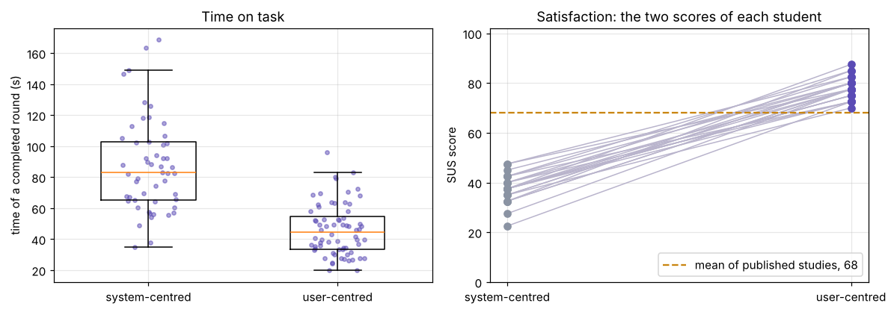
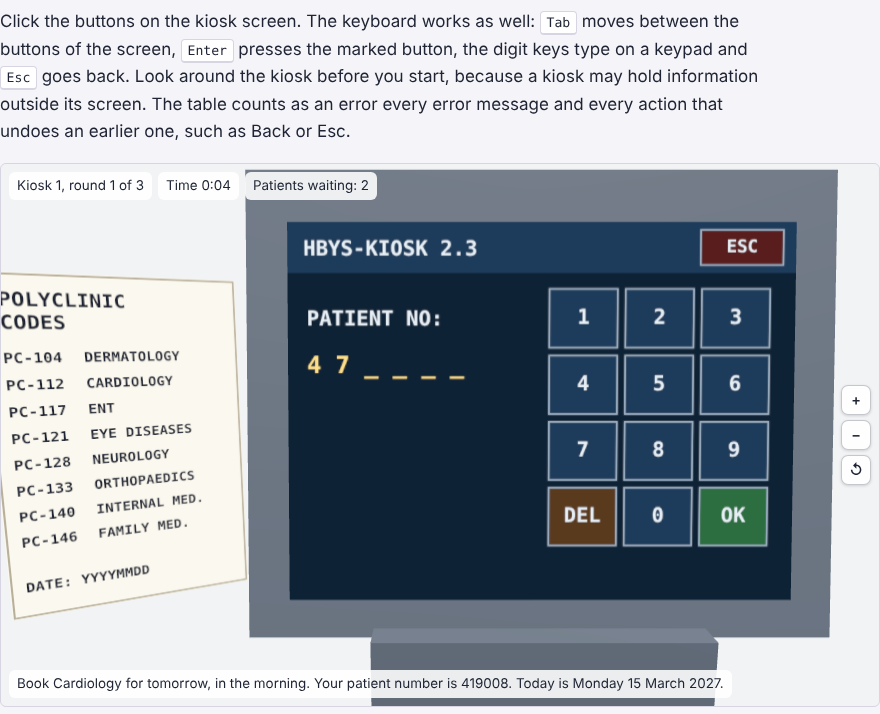

# Week 01: Foundations: The Interaction Loop, User-Centred Design and Usability

**Human-Computer Interaction (BIL-429 İnsan-Bilgisayar Etkileşimi)**  
Prof. Dr. Utku Kose, Süleyman Demirel University

   

System-centred and user-centred design, the loop of execution and evaluation, usability in four numbers, three experiments in three dimensions (3D) and a first baseline of the clinic app. **Estimated study time:** 8 to 9 hours.

## Materials of the week

Each material has its own role. Start with the lecture page; the study path below gives the order and the time of each step.

| Material | What it holds | Open |
|---|---|---|
| Lecture page | The concepts of the week, with a 3D scene, an animation, discussion questions, an interface clinic, knowledge checks, review cards and the references | [Lecture page](https://utkukose.github.io/human-computer-interaction-NB-lecture/weeks/week-01/lecture.html) |
| Colab notebook | Python step 1: Values, variables, lists and decisions with kiosk data, then six hands-on sections that analyse your own results from the games, model the booking flow, rank its steps and compare apps, with exercises, a figure in 3D and an Explore panel |  |
| Interactive lab | Interaction lab: Seven parts, among them three 3D games (the kiosk race, the corridor of doors and the cooktop), step-by-step calculators, a simulation, a self-assessment and an exportable learning log | [Interactive lab](https://utkukose.github.io/human-computer-interaction-NB-lecture/weeks/week-01/lab.html) |
| PDF lecture notes | The Python step and the lecture in one printable file | [PDF notes](Week01_Lecture_Notes.pdf) |

<table><tr><td width="50%"> From the Colab notebook</td><td width="50%"> The interactive lab</td></tr></table>

## Learning outcomes

By the end of the week, students are expected to define human-computer interaction, usability and user-centred design with their standard definitions. They should be able to contrast user-centred with system-centred design and estimate the cost of a design decision in the time of its users. They should describe the interaction loop with its gulfs of execution and evaluation. They should also compute the completion rate, the mean time on task, the efficiency and the score of the System Usability Scale (SUS) of a usability test. They should explain affordances, signifiers, constraints, mapping and feedback with examples from real interfaces. Finally, they should be able to model a task as a chain of steps and compute its probability of completion and its expected time. With the model, they should find the weakest step of an app. In Python, students are expected to use values, variables, decisions, lists, loops, functions and dictionaries.

## Study path

| Step | Activity | Suggested time |
|---|---|---|
| 1 | Read the [lecture page](https://utkukose.github.io/human-computer-interaction-NB-lecture/weeks/week-01/lecture.html), answer its knowledge checks and think through its discussion questions | 1 hour 45 minutes |
| 2 | Run Python step 1: Values, variables, lists and decisions in the [Colab notebook](https://colab.research.google.com/github/utkukose/human-computer-interaction-NB-lecture/blob/main/weeks/week-01/NB01_interaction_loop_and_usability.ipynb#scrollTo=python-step), right after the setup section | 1 hour |
| 3 | Play the three games of the [interactive lab](https://utkukose.github.io/human-computer-interaction-NB-lecture/weeks/week-01/lab.html), Parts A, C and D, and work through Parts B, E, F and G | 1 hour 30 minutes |
| 4 | Work through Sections 1 to 5 of the Colab notebook with your own results and solve the exercises | 2 hours |
| 5 | Use the application switch of Section 6 and solve the application challenge of your field | 45 minutes |
| 6 | Take the self-assessment in the [interactive lab](https://utkukose.github.io/human-computer-interaction-NB-lecture/weeks/week-01/lab.html) (tab: Check yourself) | 20 minutes |
| 7 | Write the reflection in the interactive lab, export the learning log and complete the weekly task below | 45 minutes |

## Live session plan

The week runs as one synchronous session of about three hours in class or online, and each material has one role in it. The lecture page is on the screen. At each orange Colab box, the instructor shows the matching section in a copy of the Colab notebook that has already been run. Students work in their own copy from top to bottom, and each part of the interactive lab follows the part of the lecture that it practises. The PDF lecture notes serve reading after the session, and the study path above serves self-paced study.

| Time | Activity |
|---|---|
| 0:00 to 0:15 | Opening: What human-computer interaction (HCI) studies, the plan of the course and the clinic app. Students open the Colab notebook, save a copy in Drive and run Section 0 |
| 0:15 to 0:50 | Lecture page, part 1: What is HCI, then system-centred and user-centred design with its discussion questions in pairs. Everybody plays Part A of the interactive lab, the kiosk race in 3D, and the class compares the first results |
| 0:50 to 1:10 | Colab, together: Python step 1, ending with the comparison of two groups of patients |
| 1:10 to 1:20 | Break |
| 1:20 to 1:50 | Lecture page, part 2: The interaction loop with the 3D scene Two gulfs, then usability and the System Usability Scale (SUS) with Part B. Section 1 in Colab with each student's own kiosk results |
| 1:50 to 2:20 | Lecture page, part 3: Affordances, signifiers and mapping. Students play Parts C and D, the doors and the cooktop, and paste their results into Section 2 |
| 2:20 to 2:45 | Lecture page, part 4: A task as a chain of steps with the funnel animation, Part E, Section 3 in pairs, Part F and Section 4 |
| 2:45 to 3:00 | Interface clinic and the human side with their discussion questions, the clinic app, stage 1 with Part G and Section 5, and the closing section on interaction with artificial intelligence (AI). After the session: Section 6, the self-assessment, the PDF notes and the weekly task |

## Weekly task and submission

**What to do.** First, choose an app that you use at least once a week, such as a banking, food delivery or university app, and one common task in it. Second, write down the steps of the task and estimate $t_k$, $e_k$, $r_k$ and $a_k$ for each step. Third, compute $P_0$, $\mathrm{E}[T]$ and $P_c$ with the functions of Section 3 of the Colab notebook. Finally, name the gulf behind the weakest step, say whether it comes from a system-centred decision and propose one change to the interface that narrows it.

**Where to look.** Lecture: Sections "System-centred and user-centred design", "The interaction loop: Execution and evaluation", "A task as a chain of steps" and "Interface clinic: The booking screens, before and after". Interactive lab: Parts A, E and F. Colab notebook: Sections 3, 4 and 6, and Exercise D.

**Example.** A ticket app for a city bus has five steps: Open the app, choose the line, choose the ticket type, pay and show the Quick Response (QR) code. If paying takes 25 seconds, slips with $e = 0.12$ and costs $r = 40$ seconds to repair, it adds $25 + 0.12 \times 40 = 29.8$ seconds to $\mathrm{E}[T]$ on its own. Typing the card number at every purchase is a system-centred step, and a stored payment card could cut both numbers.

**What to submit.** A report of about one page with the table of your steps, the three computed values, the weakest step with its gulf and your proposed change. Add the Colab notebook with the exercises of Week 1 completed.

The task is optional and supports self-learning and a personal portfolio. During an active semester, the items listed under What to submit can be sent together with the learning log exported from the interactive lab to utkukose@sdu.edu.tr or utkukose@gmail.com.

## Research and report assignment (optional)

**Do conversational assistants widen the gulfs?** How do the gulfs of execution and evaluation appear in studies of today's conversational and voice assistants?

**What to do.** Select eight studies published since 2018 that evaluate a conversational or voice assistant with users. For each study, note the problems that the users met and classify each problem as a gulf of execution or a gulf of evaluation &#91;[15](https://utkukose.github.io/human-computer-interaction-NB-lecture/weeks/week-01/lecture.html#ref-15)&#93;. Compare your classification with the guidelines of Amershi and colleagues &#91;[24](https://utkukose.github.io/human-computer-interaction-NB-lecture/weeks/week-01/lecture.html#ref-24)&#93; and discuss which guideline would have prevented each problem.

**Where to start.** Lecture: Sections "The interaction loop: Execution and evaluation" and "Toward human-AI interaction". The references of the lecture page give a first entry to the literature.

**Example focus.** A study may report that users did not know which commands a voice assistant understood, which is a gulf of execution. Another may report that users could not tell whether a reminder had been set, which is a gulf of evaluation.

The report should be about 1500 words with at least 8 sources, written in the [report template](../../exams/REPORT_TEMPLATE.docx). During an active semester, it can be sent to utkukose@sdu.edu.tr or utkukose@gmail.com.
