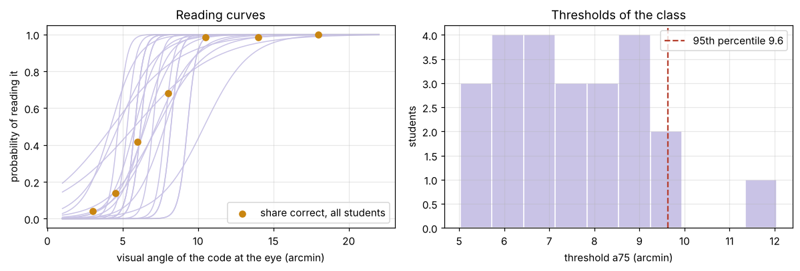
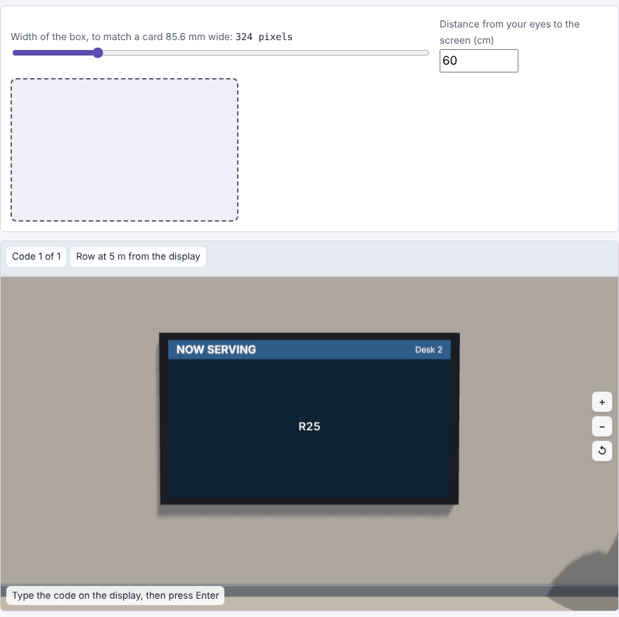

# Week 02: The Human I: Perception, Colour and Its Psychological Effects

**Human-Computer Interaction (BIL-429 İnsan-Bilgisayar Etkileşimi)**  
Prof. Dr. Utku Kose, Süleyman Demirel University

   

Visual angle, contrast, colour vision deficiency, colour difference and the psychological effects of colour, with three games in three dimensions (3D) and an audit of the clinic app. **Estimated study time:** 8 to 9 hours.

## Materials of the week

Each material has its own role. Start with the lecture page; the study path below gives the order and the time of each step.

| Material | What it holds | Open |
|---|---|---|
| Lecture page | The concepts of the week, with a 3D scene, an animation, discussion questions, an interface clinic, knowledge checks, review cards and the references | [Lecture page](https://utkukose.github.io/human-computer-interaction-NB-lecture/weeks/week-02/lecture.html) |
| Colab notebook | Python step 2: Arrays and functions for colour and contrast, then six hands-on sections that fit your reading threshold, audit contrast, simulate colour vision deficiency, compare your colour ratings with a published model and audit the clinic app, with exercises, a figure in 3D and two Explore panels |  |
| Interactive lab | Perception lab: Five parts, among them three 3D games (the queue display, follow the line and paint the waiting room), step-by-step calculators, a self-assessment and an exportable learning log | [Interactive lab](https://utkukose.github.io/human-computer-interaction-NB-lecture/weeks/week-02/lab.html) |
| PDF lecture notes | The Python step and the lecture in one printable file | [PDF notes](Week02_Lecture_Notes.pdf) |

<table><tr><td width="50%"> From the Colab notebook</td><td width="50%"> The interactive lab</td></tr></table>

## Learning outcomes

By the end of the week, students are expected to compute the visual angle of a text and judge it against the critical print size. They should be able to explain how a screen mixes colours and turn sRGB values into linear light and relative luminance. They should compute the contrast ratio of two colours and apply the levels of the Web Content Accessibility Guidelines (WCAG). They should also describe the kinds of colour vision deficiency, simulate them with a matrix and measure colour differences in the colour space CIELAB of the International Commission on Illumination. Finally, they should be able to discuss the psychological effects of colour with their evidence and limits, and audit an app for colour, contrast and size. In Python, students are expected to use NumPy arrays, masks, functions with default values, two-dimensional arrays and the matrix product.

## Study path

| Step | Activity | Suggested time |
|---|---|---|
| 1 | Read the [lecture page](https://utkukose.github.io/human-computer-interaction-NB-lecture/weeks/week-02/lecture.html), answer its knowledge checks and think through its discussion questions | 1 hour 45 minutes |
| 2 | Run Python step 2: Arrays and functions for colour and contrast in the [Colab notebook](https://colab.research.google.com/github/utkukose/human-computer-interaction-NB-lecture/blob/main/weeks/week-02/NB02_perception_and_colour.ipynb#scrollTo=python-step), right after the setup section | 1 hour |
| 3 | Play the three games of the [interactive lab](https://utkukose.github.io/human-computer-interaction-NB-lecture/weeks/week-02/lab.html), Parts A, C and D, and work through Parts B and E | 1 hour 30 minutes |
| 4 | Work through Sections 1 to 5 of the Colab notebook with your own results and solve the exercises | 2 hours |
| 5 | Use the application switch of Section 6 and solve the application challenge of your field | 45 minutes |
| 6 | Take the self-assessment in the [interactive lab](https://utkukose.github.io/human-computer-interaction-NB-lecture/weeks/week-02/lab.html) (tab: Check yourself) | 20 minutes |
| 7 | Write the reflection in the interactive lab, export the learning log and complete the weekly task below | 45 minutes |

## Live session plan

The week runs as one synchronous session of about three hours in class or online, and each material has one role in it. The lecture page is on the screen. At each orange Colab box, the instructor shows the matching section in a copy of the Colab notebook that has already been run. Students work in their own copy from top to bottom, and each part of the interactive lab follows the part of the lecture that it practises. The PDF lecture notes serve reading after the session, and the study path above serves self-paced study.

| Time | Activity |
|---|---|
| 0:00 to 0:15 | Opening: The clinic app so far and the question of the week, whether patients can see the screens. Students open the Colab notebook, save a copy in Drive and run Section 0 |
| 0:15 to 0:45 | Lecture page, part 1: The eye and the visual angle with its discussion questions. Everybody plays Part A of the interactive lab, the queue display in 3D, and runs Section 1 |
| 0:45 to 1:05 | Colab, together: Python step 2, ending with a matrix that transforms a whole palette |
| 1:05 to 1:15 | Break |
| 1:15 to 1:45 | Lecture page, part 2: Colour on a screen with the animation of three lights, then luminance and contrast with Part B and Section 2 |
| 1:45 to 2:15 | Lecture page, part 3: Colour vision and its deficiencies with the 3D scene Five pairs of eyes. Students play Part C, follow the line, then CIELAB and Section 3 |
| 2:15 to 2:40 | Lecture page, part 4: The psychological effects of colour. Students play Part D, paint the waiting room, and compare their weights in Section 4 |
| 2:40 to 3:00 | Interface clinic and the human side with their discussion questions, the clinic app, stage 2 with Part E and Section 5, and the closing section on colour in interfaces of artificial intelligence (AI). After the session: Section 6, the self-assessment, the PDF notes and the weekly task |

## Weekly task and submission

**What to do.** First, choose an app that you use at least once a week and take screenshots of three of its screens. Second, read the colour codes of at least six pairs of text and background with a colour picker. Compute their contrast ratios with the functions of Section 2 of the Colab notebook. Third, simulate the colour signals of the app, such as status colours or chart colours, with deuteranopia, and compute $\Delta E^*_{ab}$ for each pair of signals. Finally, propose a redesign of the weakest pair and the weakest colour signal, and check that your redesign passes level AA.

**Where to look.** Lecture: Sections "Luminance and contrast", "Colour vision and its deficiencies", "Measuring colour difference: CIELAB" and "Interface clinic: Colour and type on the clinic screens, before and after". Interactive lab: Parts B and C. Colab notebook: Sections 2, 3 and 6, and Exercises B and C.

**Example.** A banking app prints transaction dates in #9AA5A0 on white, with a ratio of 2.54. Darkening the grey to #5E6B66 keeps its hue and raises the ratio to 5.57. Its green and red arrows for income and spending differ by a large $\Delta E^*_{ab}$ for typical vision but much less with deuteranopia. A plus and a minus sign beside the amounts would carry the message.

**What to submit.** A report of about two pages with your screenshots, the table of colour pairs and ratios, the simulated signals with their $\Delta E^*_{ab}$ and your redesign. Add the Colab notebook with the exercises of Week 2 completed.

The task is optional and supports self-learning and a personal portfolio. During an active semester, the items listed under What to submit can be sent together with the learning log exported from the interactive lab to utkukose@sdu.edu.tr or utkukose@gmail.com.

## Research and report assignment (optional)

**Colour and emotion in interfaces: What does the evidence say?** What do studies published since 2015 show about the effects of interface colours on the emotions, trust or performance of users?

**What to do.** Select eight empirical studies published since 2015 that vary the colours of an interface, a website or an app and measure emotions, trust or performance. For each study, note the design, the number of participants, the colours compared and the size of the effect. Compare the findings with the equations of Valdez and Mehrabian &#91;[11](https://utkukose.github.io/human-computer-interaction-NB-lecture/weeks/week-02/lecture.html#ref-11)&#93; and with the cautions of Elliot and Maier &#91;[13](https://utkukose.github.io/human-computer-interaction-NB-lecture/weeks/week-02/lecture.html#ref-13)&#93;. Then discuss which findings would justify a design decision for the clinic app.

**Where to start.** Lecture: Section "The psychological effects of colour". The references of the lecture page give a first entry to the literature.

**Example focus.** A study may compare a blue and a red version of a shopping site and report higher trust for blue. Before such a finding guides a design, it matters how many participants took part, whether brightness and saturation were controlled and whether the result was replicated.

The report should be about 1500 words with at least 8 sources, written in the [report template](../../exams/REPORT_TEMPLATE.docx). During an active semester, it can be sent to utkukose@sdu.edu.tr or utkukose@gmail.com.
