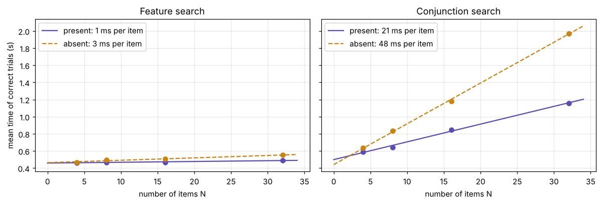
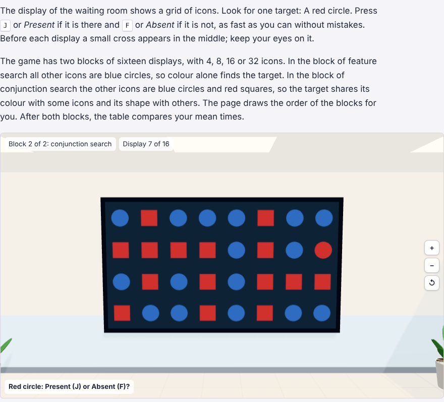

# Week 03: The Human II: Attention, Memory and Decisions

**Human-Computer Interaction (BIL-429 İnsan-Bilgisayar Etkileşimi)**  
Prof. Dr. Utku Kose, Süleyman Demirel University

   

Visual search, the Hick-Hyman law, working memory, defaults and menus from novice to expert, with three games in three dimensions (3D) and forms that need less memory. **Estimated study time:** 8 to 9 hours.

## Materials of the week

Each material has its own role. Start with the lecture page; the study path below gives the order and the time of each step.

| Material | What it holds | Open |
|---|---|---|
| Lecture page | The concepts of the week, with a 3D scene, an animation, discussion questions, an interface clinic, knowledge checks, review cards and the references | [Lecture page](https://utkukose.github.io/human-computer-interaction-NB-lecture/weeks/week-03/lecture.html) |
| Colab notebook | Python step 3: Random numbers, timing and a first fit, then six hands-on sections that fit your search lines, your rate of gain of information and your memory span, model menus from novice to expert and compute stage 3 of the clinic app, with exercises and an Explore panel |  |
| Interactive lab | Attention and memory lab: Five parts, among them three 3D games (find the icon, Hick lamps and remember the code), step-by-step calculators, a self-assessment and an exportable learning log | [Interactive lab](https://utkukose.github.io/human-computer-interaction-NB-lecture/weeks/week-03/lab.html) |
| PDF lecture notes | The Python step and the lecture in one printable file | [PDF notes](Week03_Lecture_Notes.pdf) |

<table><tr><td width="50%"> From the Colab notebook</td><td width="50%"> The interactive lab</td></tr></table>

## Learning outcomes

By the end of the week, students are expected to explain feature and conjunction search and predict search times with the model of serial search. They should be able to apply the Hick-Hyman law and compute the information of a choice with equal and unequal probabilities. They should describe the limits of working memory, use chunks and the span curve, and prefer recognition to recall in design. They should also estimate the effect of a default and discuss the evidence on choice overload. Finally, they should be able to model menus from novice to expert and choose a design for both. In Python, students are expected to use random generators, simulate and summarise reaction times, measure the duration of code and fit a straight line.

## Study path

| Step | Activity | Suggested time |
|---|---|---|
| 1 | Read the [lecture page](https://utkukose.github.io/human-computer-interaction-NB-lecture/weeks/week-03/lecture.html), answer its knowledge checks and think through its discussion questions | 1 hour 45 minutes |
| 2 | Run Python step 3: Random numbers, timing and a first fit in the [Colab notebook](https://colab.research.google.com/github/utkukose/human-computer-interaction-NB-lecture/blob/main/weeks/week-03/NB03_attention_memory_decisions.ipynb#scrollTo=python-step), right after the setup section | 1 hour |
| 3 | Play the three games of the [interactive lab](https://utkukose.github.io/human-computer-interaction-NB-lecture/weeks/week-03/lab.html), Parts A, C and D, and work through Parts B and E | 1 hour 30 minutes |
| 4 | Work through Sections 1 to 5 of the Colab notebook with your own results and solve the exercises | 2 hours |
| 5 | Use the application switch of Section 6 and solve the application challenge of your field | 45 minutes |
| 6 | Take the self-assessment in the [interactive lab](https://utkukose.github.io/human-computer-interaction-NB-lecture/weeks/week-03/lab.html) (tab: Check yourself) | 20 minutes |
| 7 | Write the reflection in the interactive lab, export the learning log and complete the weekly task below | 45 minutes |

## Live session plan

The week runs as one synchronous session of about three hours in class or online, and each material has one role in it. The lecture page is on the screen. At each orange Colab box, the instructor shows the matching section in a copy of the Colab notebook that has already been run. Students work in their own copy from top to bottom, and each part of the interactive lab follows the part of the lecture that it practises. The PDF lecture notes serve reading after the session, and the study path above serves self-paced study.

| Time | Activity |
|---|---|
| 0:00 to 0:15 | Opening: The clinic app so far and the question of the week, what patients must find, remember and decide. Students open the Colab notebook, save a copy in Drive and run Section 0 |
| 0:15 to 0:45 | Lecture page, part 1: Attention and visual search with its discussion questions. Everybody plays Part A of the interactive lab, find the icon in 3D, and runs Section 1 |
| 0:45 to 1:05 | Colab, together: Python step 3, ending with a straight line through measured means |
| 1:05 to 1:15 | Break |
| 1:15 to 1:45 | Lecture page, part 2: The Hick-Hyman law with Part B, the lamps of Part C and Section 2 |
| 1:45 to 2:15 | Lecture page, part 3: Memory with the animation of chunks, Part D and Section 3, then decisions and defaults with their discussion questions |
| 2:15 to 2:40 | Lecture page, part 4: Menus from search to decision with the 3D scene Where attention goes and Section 4 |
| 2:40 to 3:00 | Interface clinic and the human side with their discussion questions, the clinic app, stage 3 with Part E and Section 5, and the closing section on attention to suggestions of artificial intelligence (AI). After the session: Section 6, the self-assessment, the PDF notes and the weekly task |

## Weekly task and submission

**What to do.** First, choose an app with a menu or a list of at least 15 items, such as a food delivery or a banking app. Second, count the items, estimate the share of the most frequent ones and measure, with a stopwatch, how long you need to find three items that you rarely use. Third, compute the expected times of a flat, a grouped and a split menu for a novice and an expert with `menu_time` or `app_times` of the Colab notebook. Finally, list every code or number that the app asks you to copy or remember, and propose how the app could put that knowledge in the world.

**Where to look.** Lecture: Sections "Attention and visual search", "Memory: Holding and recalling" and "Menus: From search to decision". Interactive lab: Parts A and D. Colab notebook: Sections 4 and 6, and Exercise D.

**Example.** A food delivery app lists 120 restaurants. A novice who reads 0.25 s per name needs about 15.5 s for a present target. With a list of six recent restaurants on top, a repeat order is found in about 1.3 s. The app also asks for a six-digit code from a text message, which phones can fill in automatically.

**What to submit.** A report of about two pages with your counts, your measured times, the three model predictions with your parameters, the list of memory demands and your proposals. Add the Colab notebook with the exercises of Week 3 completed.

The task is optional and supports self-learning and a personal portfolio. During an active semester, the items listed under What to submit can be sent together with the learning log exported from the interactive lab to utkukose@sdu.edu.tr or utkukose@gmail.com.

## Research and report assignment (optional)

**Defaults in digital health** How do defaults in digital health services, such as appointment reminders, privacy settings or screening invitations, affect what people end up with?

**What to do.** Select eight empirical studies published since 2015 that compare default settings in health services, apps or online forms. For each study, note the default, the alternative, the sample and the effect on the share of people with each setting. Compare the findings with the study of Johnson and Goldstein &#91;[10](https://utkukose.github.io/human-computer-interaction-NB-lecture/weeks/week-03/lecture.html#ref-10)&#93;. Then discuss when a default serves the people who keep it and when it serves the provider.

**Where to start.** Lecture: Section "Decisions and defaults". The references of the lecture page give a first entry to the literature.

**Example focus.** A study may compare reminder messages that are sent by default with messages that patients must request, and report the attendance rate in both groups. The share of patients who switch the reminder off tells whether the default suited them.

The report should be about 1500 words with at least 8 sources, written in the [report template](../../exams/REPORT_TEMPLATE.docx). During an active semester, it can be sent to utkukose@sdu.edu.tr or utkukose@gmail.com.
