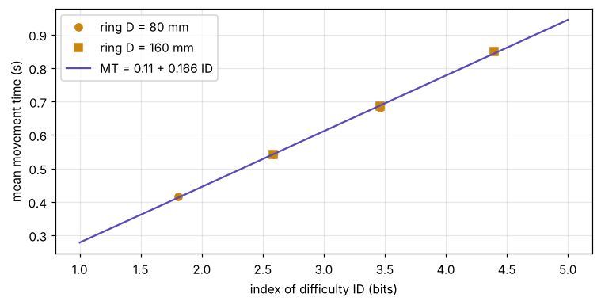
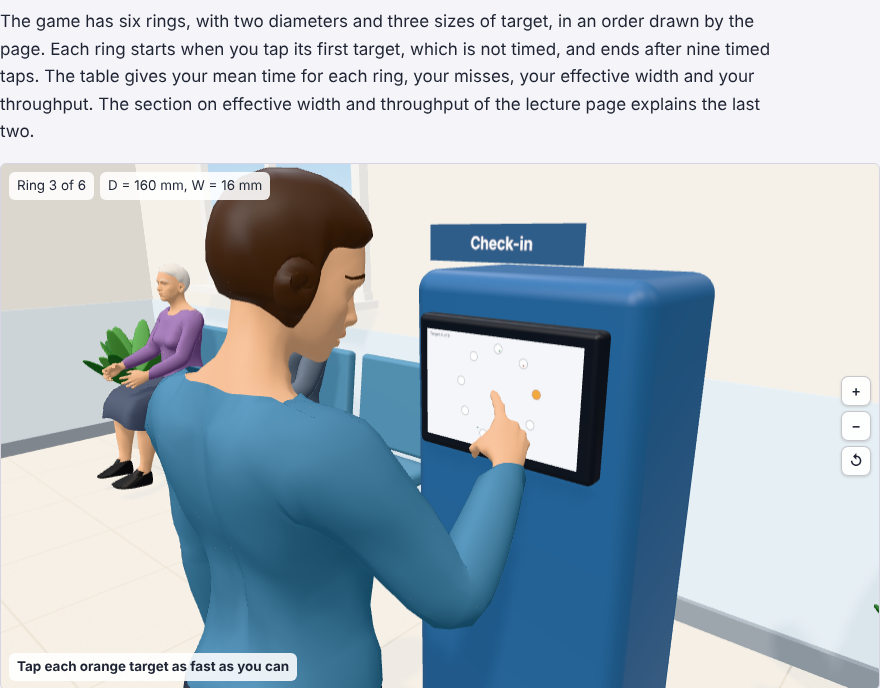

# Week 04: The Human III: Movement, Pointing and Input

**Human-Computer Interaction (BIL-429 İnsan-Bilgisayar Etkileşimi)**  
Prof. Dr. Utku Kose, Süleyman Demirel University

   

Fitts' law, throughput, touch, tremor and the steering law, with three games in three dimensions (3D) and targets that fit every hand. **Estimated study time:** 8 to 9 hours.

## Materials of the week

Each material has its own role. Start with the lecture page; the study path below gives the order and the time of each step.

| Material | What it holds | Open |
|---|---|---|
| Lecture page | The concepts of the week, with a 3D scene, an animation, discussion questions, an interface clinic, knowledge checks, review cards and the references | [Lecture page](https://utkukose.github.io/human-computer-interaction-NB-lecture/weeks/week-04/lecture.html) |
| Colab notebook | Python step 4: Least squares and residuals, then six hands-on sections that fit your own Fitts' law, compute your effective width and throughput, model touch with a tremor, fit the steering law and compute stage 4 of the clinic app, with exercises and an Explore panel |  |
| Interactive lab | Pointing and touch lab: Five parts, among them three 3D games (the ring of targets, the tremor kiosk and the buzz wire), step-by-step calculators, a self-assessment and an exportable learning log | [Interactive lab](https://utkukose.github.io/human-computer-interaction-NB-lecture/weeks/week-04/lab.html) |
| PDF lecture notes | The Python step and the lecture in one printable file | [PDF notes](Week04_Lecture_Notes.pdf) |

<table><tr><td width="50%"> From the Colab notebook</td><td width="50%"> The interactive lab</td></tr></table>

## Learning outcomes

By the end of the week, students are expected to explain the speed-accuracy trade-off and the model of corrections behind Fitts' law. They should be able to compute the index of difficulty, the movement time, the effective width and the throughput. They should model the spread of touch with a tremor and compute the probability of hitting a button and the width for a given hit rate. They should also apply the steering law to menus and sliders. Finally, they should be able to audit the targets of an app for groups of users. In Python, students are expected to fit a line by least squares, compute residuals and the coefficient of determination, and summarise the spread of landing points.

## Study path

| Step | Activity | Suggested time |
|---|---|---|
| 1 | Read the [lecture page](https://utkukose.github.io/human-computer-interaction-NB-lecture/weeks/week-04/lecture.html), answer its knowledge checks and think through its discussion questions | 1 hour 45 minutes |
| 2 | Run Python step 4: Least squares and residuals in the [Colab notebook](https://colab.research.google.com/github/utkukose/human-computer-interaction-NB-lecture/blob/main/weeks/week-04/NB04_pointing_and_input.ipynb#scrollTo=python-step), right after the setup section | 1 hour |
| 3 | Play the three games of the [interactive lab](https://utkukose.github.io/human-computer-interaction-NB-lecture/weeks/week-04/lab.html), Parts A, C and D, and work through Parts B and E | 1 hour 30 minutes |
| 4 | Work through Sections 1 to 5 of the Colab notebook with your own results and solve the exercises | 2 hours |
| 5 | Use the application switch of Section 6 and solve the application challenge of your field | 45 minutes |
| 6 | Take the self-assessment in the [interactive lab](https://utkukose.github.io/human-computer-interaction-NB-lecture/weeks/week-04/lab.html) (tab: Check yourself) | 20 minutes |
| 7 | Write the reflection in the interactive lab, export the learning log and complete the weekly task below | 45 minutes |

## Live session plan

The week runs as one synchronous session of about three hours in class or online, and each material has one role in it. The lecture page is on the screen. At each orange Colab box, the instructor shows the matching section in a copy of the Colab notebook that has already been run. Students work in their own copy from top to bottom, and each part of the interactive lab follows the part of the lecture that it practises. The PDF lecture notes serve reading after the session, and the study path above serves self-paced study.

| Time | Activity |
|---|---|
| 0:00 to 0:15 | Opening: The clinic app so far and the question of the week, how patients reach what they chose. Students open the Colab notebook, save a copy in Drive and run Section 0 |
| 0:15 to 0:35 | Colab, together: Python step 4, ending with a least-squares line and its residuals |
| 0:35 to 1:05 | Lecture page, part 1: Aimed movements with the animation, then Fitts' law with Part A of the interactive lab and Section 1 |
| 1:05 to 1:15 | Break |
| 1:15 to 1:35 | Lecture page, part 2: Effective width and throughput, with Section 2 on the taps of Part A |
| 1:35 to 2:10 | Lecture page, part 3: Touch, fingers and tremor with the 3D scene Where the taps land, Parts B and C and Section 3 |
| 2:10 to 2:35 | Lecture page, part 4: The steering law with the buzz wire of Part D and Section 4 |
| 2:35 to 3:00 | Interface clinic and the human side with their discussion questions, the clinic app, stage 4 with Part E and Section 5, and the closing section on keyboards that adapt with artificial intelligence (AI). After the session: Section 6, the self-assessment, the PDF notes and the weekly task |

## Weekly task and submission

**What to do.** First, choose an app on your phone and list five of its targets, such as buttons, links or checkboxes. Second, measure each target and its usual distance from the thumb with a ruler on the screen. Third, compute the index of difficulty, the movement time and the hit rate for the three groups of patients with `fitts_time` and `p_hit` of the Colab notebook. Finally, propose new sizes and positions for the two worst targets and compute their values again.

**Where to look.** Lecture: Sections "Fitts' law" and "Touch, fingers and tremor". Interactive lab: Parts A, B and C. Colab notebook: Sections 1, 3 and 6, and Exercise C.

**Example.** The quantity buttons of a food delivery app are 6 mm wide and 25 mm from the thumb. Their movement time is about 0.48 s, but a patient with tremor hits them only about once in four taps. Buttons of 14 mm would raise this to about eight taps in ten.

**What to submit.** A report of about two pages with your measurements, the computed values for the three groups and your proposals. Add the Colab notebook with the exercises of Week 4 completed.

The task is optional and supports self-learning and a personal portfolio. During an active semester, the items listed under What to submit can be sent together with the learning log exported from the interactive lab to utkukose@sdu.edu.tr or utkukose@gmail.com.

## Research and report assignment (optional)

**Target sizes for older adults on touch screens** Which target sizes and spacings do older adults need on touch screens, and how much does a tremor change the answer?

**What to do.** Select eight empirical studies published since 2010 that measure the tapping accuracy or speed of older adults on touch screens. For each study, note the sample, the target sizes and spacings, and the measures of performance. Compare the recommended sizes with the 9.2 mm of Parhi, Karlson and Bederson &#91;[9](https://utkukose.github.io/human-computer-interaction-NB-lecture/weeks/week-04/lecture.html#ref-9)&#93;. Then discuss what the studies imply for the kiosks of a hospital.

**Where to start.** Lecture: Section "Touch, fingers and tremor". The references of the lecture page give a first entry to the literature.

**Example focus.** A study may compare targets of 5, 10 and 15 mm for adults over 65 and report the error rate for each. The size at which the errors stop falling is the recommendation to compare.

The report should be about 1500 words with at least 8 sources, written in the [report template](../../exams/REPORT_TEMPLATE.docx). During an active semester, it can be sent to utkukose@sdu.edu.tr or utkukose@gmail.com.
