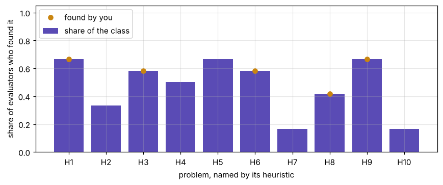
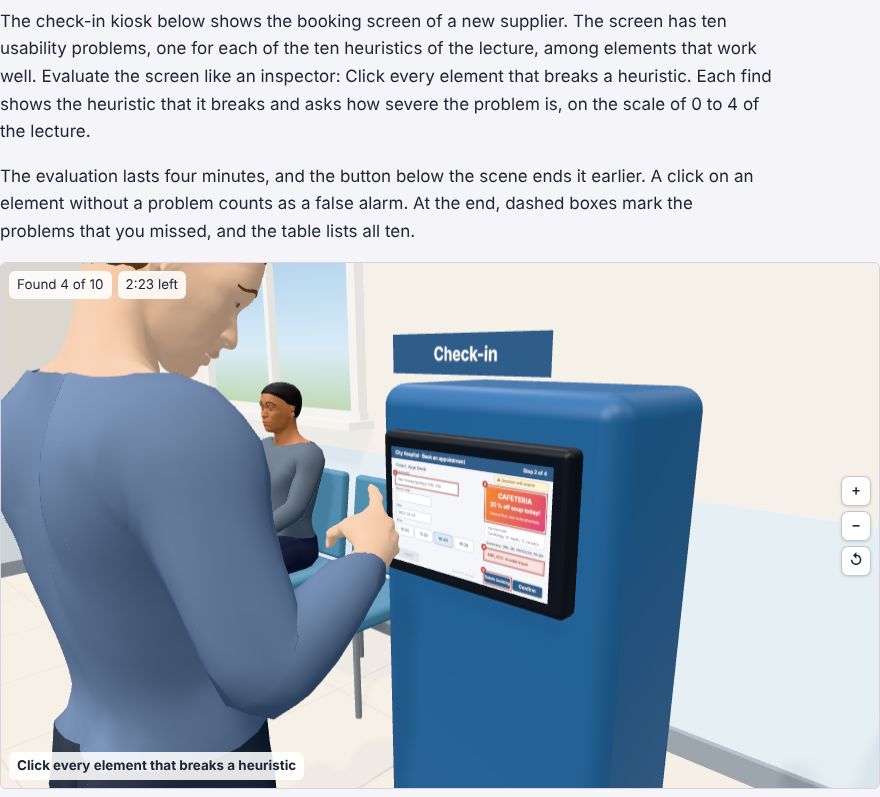

# Week 05: Design Principles, Heuristics and Human Error

**Human-Computer Interaction (BIL-429 İnsan-Bilgisayar Etkileşimi)**  
Prof. Dr. Utku Kose, Süleyman Demirel University

   

Heuristic evaluation, the number of evaluators, slips, mode errors and defences in layers, with three games in three dimensions (3D) and a ranked list of problems. **Estimated study time:** 8 to 9 hours.

## Materials of the week

Each material has its own role. Start with the lecture page; the study path below gives the order and the time of each step.

| Material | What it holds | Open |
|---|---|---|
| Lecture page | The concepts of the week, with a 3D scene, an animation, discussion questions, an interface clinic, knowledge checks, review cards and the references | [Lecture page](https://utkukose.github.io/human-computer-interaction-NB-lecture/weeks/week-05/lecture.html) |
| Colab notebook | Python step 5: Matrices of zeros and ones, then six hands-on sections that measure the agreement of evaluators, estimate and adjust the discovery rate, turn mode errors into errors per year, simulate defences in layers and compute stage 5 of the clinic app, with exercises and an Explore panel |  |
| Interactive lab | Heuristics and error lab: Five parts, among them three 3D games (the heuristic hunt, the infusion pump and the look-alike drugs), step-by-step calculators, a self-assessment and an exportable learning log | [Interactive lab](https://utkukose.github.io/human-computer-interaction-NB-lecture/weeks/week-05/lab.html) |
| PDF lecture notes | The Python step and the lecture in one printable file | [PDF notes](Week05_Lecture_Notes.pdf) |

<table><tr><td width="50%"> From the Colab notebook</td><td width="50%"> The interactive lab</td></tr></table>

## Learning outcomes

By the end of the week, students are expected to explain how heuristics turn design principles into questions for an inspector. They should be able to run a heuristic evaluation, rate severity and compute the agreement of evaluators. They should estimate how many evaluators a goal requires and adjust the discovery rate of a small team. They should also classify errors as slips, lapses, mistakes or violations and explain mode errors. Finally, they should be able to compute the harm that passes layers of defence. In Python, students are expected to build matrices of zeros and ones, sum them along rows and columns and sort tables by several columns.

## Study path

| Step | Activity | Suggested time |
|---|---|---|
| 1 | Read the [lecture page](https://utkukose.github.io/human-computer-interaction-NB-lecture/weeks/week-05/lecture.html), answer its knowledge checks and think through its discussion questions | 1 hour 45 minutes |
| 2 | Run Python step 5: Matrices of zeros and ones in the [Colab notebook](https://colab.research.google.com/github/utkukose/human-computer-interaction-NB-lecture/blob/main/weeks/week-05/NB05_heuristics_and_error.ipynb#scrollTo=python-step), right after the setup section | 1 hour |
| 3 | Play the three games of the [interactive lab](https://utkukose.github.io/human-computer-interaction-NB-lecture/weeks/week-05/lab.html), Parts A, C and D, and work through Parts B and E | 1 hour 30 minutes |
| 4 | Work through Sections 1 to 5 of the Colab notebook with your own results and solve the exercises | 2 hours |
| 5 | Use the application switch of Section 6 and solve the application challenge of your field | 45 minutes |
| 6 | Take the self-assessment in the [interactive lab](https://utkukose.github.io/human-computer-interaction-NB-lecture/weeks/week-05/lab.html) (tab: Check yourself) | 20 minutes |
| 7 | Write the reflection in the interactive lab, export the learning log and complete the weekly task below | 45 minutes |

## Live session plan

The week runs as one synchronous session of about three hours in class or online, and each material has one role in it. The lecture page is on the screen. At each orange Colab box, the instructor shows the matching section in a copy of the Colab notebook that has already been run. Students work in their own copy from top to bottom, and each part of the interactive lab follows the part of the lecture that it practises. The PDF lecture notes serve reading after the session, and the study path above serves self-paced study.

| Time | Activity |
|---|---|
| 0:00 to 0:15 | Opening: The clinic app so far and the question of the week, how to find problems before patients do. Students open the Colab notebook, save a copy in Drive and run Section 0 |
| 0:15 to 0:35 | Colab, together: Python step 5, ending with a table of problems sorted by severity |
| 0:35 to 1:05 | Lecture page, part 1: From principles to heuristics and heuristic evaluation, with the hunt of Part A of the interactive lab and Section 1 |
| 1:05 to 1:15 | Break |
| 1:15 to 1:35 | Lecture page, part 2: How many evaluators, with the animation, Part B and Section 2 |
| 1:35 to 2:05 | Lecture page, part 3: Slips, lapses, mistakes and modes, with the infusion pump of Part C and Section 3 |
| 2:05 to 2:35 | Lecture page, part 4: Defences in layers with the 3D scene The journey of an order, the medication room of Part D and Section 4 |
| 2:35 to 3:00 | Interface clinic and the human side with their discussion questions, the clinic app, stage 5 with Part E and Section 5, and the closing section on guidelines for human-AI interaction. After the session: Section 6, the self-assessment, the PDF notes and the weekly task |

## Weekly task and submission

**What to do.** First, choose an app or a website that you use and inspect it with two classmates, each of you alone, with the ten heuristics. Second, merge your three lists, rate the severity of each problem and build the matrix of who found what. Third, compute the agreement of each pair and the adjusted discovery rate with the functions of Sections 1 and 2 of the Colab notebook. Finally, rank the problems and propose a fix for the two most severe ones.

**Where to look.** Lecture: Sections "Heuristic evaluation" and "How many evaluators?". Interactive lab: Parts A and B. Colab notebook: Sections 1, 2 and 5, and Exercises A and B.

**Example.** Three students inspected a train ticket app and found 14 problems; the matrix holds 19 ones, and 9 problems were found once. Then $\lambda_{est} = 19/42 = 0.452$, $GT_{adj} = 9/14 = 0.643$ and $\lambda_{adj}$ is about 0.18, so the three students found only about 44 percent of the problems.

**What to submit.** A report of about two pages with your merged list, the severity ratings, the matrix, the computed values and your proposals. Add the Colab notebook with the exercises of Week 5 completed.

The task is optional and supports self-learning and a personal portfolio. During an active semester, the items listed under What to submit can be sent together with the learning log exported from the interactive lab to utkukose@sdu.edu.tr or utkukose@gmail.com.

## Research and report assignment (optional)

**Usability problems of infusion pumps and their remedies** Which usability problems of infusion pumps have studies documented, and which design changes reduced programming errors?

**What to do.** Select eight empirical studies published since 2005 that evaluate the user interface of infusion pumps, for example with heuristic evaluation, observation or simulation. For each study, note the method, the problems found and their severity, and any measured effect of a redesign. Compare the problems with the ten heuristics and with the mode errors of the lecture. Then discuss what the studies imply for the devices of a hospital ward.

**Where to start.** Lecture: Sections "Heuristic evaluation" and "Human error: Slips, lapses, mistakes and modes". The references of the lecture page give a first entry to the literature.

**Example focus.** A study may compare two pumps in a simulated ward and count the programming errors of nurses with each. Note which features of the better pump explain the difference.

The report should be about 1500 words with at least 8 sources, written in the [report template](../../exams/REPORT_TEMPLATE.docx). During an active semester, it can be sent to utkukose@sdu.edu.tr or utkukose@gmail.com.
