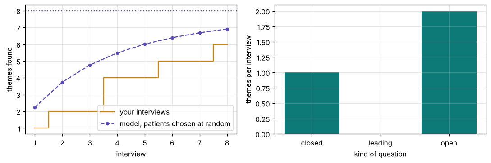
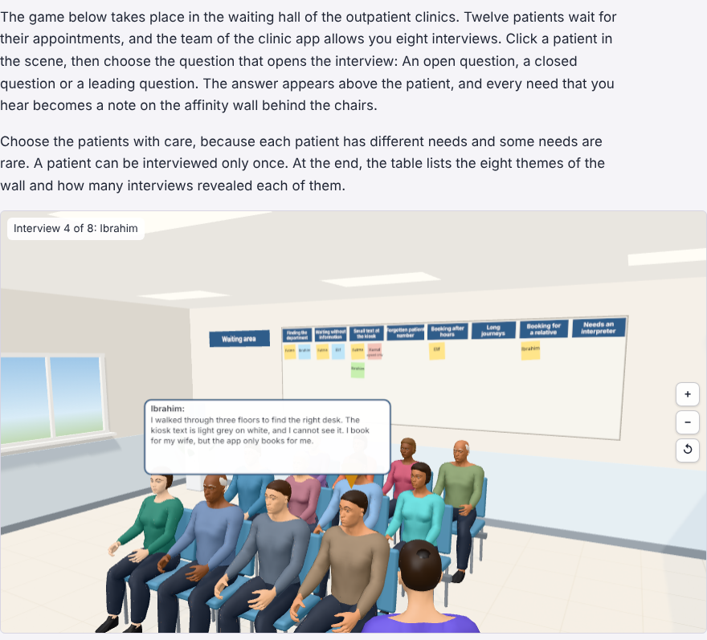

# Week 06: User-Centred Design in Practice: Interviews, Personas and Tasks

**Human-Computer Interaction (BIL-429 İnsan-Bilgisayar Etkileşimi)**  
Prof. Dr. Utku Kose, Süleyman Demirel University

   

Interviews and saturation, personas from data with k-means, hierarchical task analysis and the keystroke-level model, with three games in three dimensions (3D) and predicted booking times for three personas. **Estimated study time:** 8 to 9 hours.

## Materials of the week

Each material has its own role. Start with the lecture page; the study path below gives the order and the time of each step.

| Material | What it holds | Open |
|---|---|---|
| Lecture page | The concepts of the week, with a 3D scene, an animation, discussion questions, an interface clinic, knowledge checks, review cards and the references | [Lecture page](https://utkukose.github.io/human-computer-interaction-NB-lecture/weeks/week-06/lecture.html) |
| Colab notebook | Python step 6: Scaling, distances and groups, then six hands-on sections that draw a saturation curve, build personas with k-means, compute the expected time of a task, predict task times with the keystroke-level model and compute stage 6 of the clinic app, with exercises |  |
| Interactive lab | Users and tasks lab: Five parts, among them three 3D games (the interviews, the persona hall and the front desk race), step-by-step calculators, a self-assessment and an exportable learning log | [Interactive lab](https://utkukose.github.io/human-computer-interaction-NB-lecture/weeks/week-06/lab.html) |
| PDF lecture notes | The Python step and the lecture in one printable file | [PDF notes](Week06_Lecture_Notes.pdf) |

<table><tr><td width="50%"> From the Colab notebook</td><td width="50%"> The interactive lab</td></tr></table>

## Learning outcomes

By the end of the week, students are expected to link the methods of the week to the activities of human-centred design. They should be able to plan interviews with open questions and estimate how many interviews a rare need requires. They should build personas from data with z-scores, distances and k-means. They should also break a task into subtasks with plans and compute its expected time. Finally, they should be able to predict task times with the keystroke-level model. In Python, students are expected to scale the columns of a table, compute distances and group rows with scikit-learn.

## Study path

| Step | Activity | Suggested time |
|---|---|---|
| 1 | Read the [lecture page](https://utkukose.github.io/human-computer-interaction-NB-lecture/weeks/week-06/lecture.html), answer its knowledge checks and think through its discussion questions | 1 hour 45 minutes |
| 2 | Run Python step 6: Scaling, distances and groups in the [Colab notebook](https://colab.research.google.com/github/utkukose/human-computer-interaction-NB-lecture/blob/main/weeks/week-06/NB06_users_and_tasks.ipynb#scrollTo=python-step), right after the setup section | 1 hour |
| 3 | Play the three games of the [interactive lab](https://utkukose.github.io/human-computer-interaction-NB-lecture/weeks/week-06/lab.html), Parts A, B and D, and work through Parts C and E | 1 hour 30 minutes |
| 4 | Work through Sections 1 to 5 of the Colab notebook with your own results and solve the exercises | 2 hours |
| 5 | Use the application switch of Section 6 and solve the application challenge of your field | 45 minutes |
| 6 | Take the self-assessment in the [interactive lab](https://utkukose.github.io/human-computer-interaction-NB-lecture/weeks/week-06/lab.html) (tab: Check yourself) | 20 minutes |
| 7 | Write the reflection in the interactive lab, export the learning log and complete the weekly task below | 45 minutes |

## Live session plan

The week runs as one synchronous session of about three hours in class or online, and each material has one role in it. The lecture page is on the screen. At each orange Colab box, the instructor shows the matching section in a copy of the Colab notebook that has already been run. Students work in their own copy from top to bottom, and each part of the interactive lab follows the part of the lecture that it practises. The PDF lecture notes serve reading after the session, and the study path above serves self-paced study.

| Time | Activity |
|---|---|
| 0:00 to 0:15 | Opening: The clinic app so far and the question of the week, who the patients are and what they do. Students open the Colab notebook, save a copy in Drive and run Section 0 |
| 0:15 to 0:35 | Colab, together: Python step 6, ending with k-means on four example people |
| 0:35 to 1:05 | Lecture page, part 1: From the cycle to the methods and interviews with saturation, with the interviews of Part A of the interactive lab and Section 1 |
| 1:05 to 1:30 | Lecture page, part 2: Personas with the animation of k-means, the persona hall of Part B and Section 2 |
| 1:30 to 1:40 | Break |
| 1:40 to 2:00 | Lecture page, part 3: Hierarchical task analysis with Part C and Section 3 |
| 2:00 to 2:35 | Lecture page, part 4: The keystroke-level model with the 3D scene Three personas at the kiosk, the front desk race of Part D and Section 4 |
| 2:35 to 3:00 | Interface clinic and the human side with their discussion questions, the clinic app, stage 6 with Part E and Section 5, and the closing section on synthetic users. After the session: Section 6, the self-assessment, the PDF notes and the weekly task |

## Weekly task and submission

**What to do.** First, choose an app or a service that you use and interview three of its users with an open question about their last use. Second, write their needs on notes, group them into themes and draw the saturation curve of your three interviews. Third, describe one persona for the most frequent group of users and break its most frequent task into subtasks with a plan. Finally, write the task as a sequence of operators of the keystroke-level model and predict its time with the function of Section 4.

**Where to look.** Lecture: Sections "Interviews and saturation", "Personas", "Hierarchical task analysis" and "Predicting task times: The keystroke-level model". Interactive lab: Parts A, C and D. Colab notebook: Sections 1, 3 and 4, and Exercises A, C and D.

**Example.** Three users of a train ticket app named seven needs, and the third interview added one new theme. The persona Deniz, 24, buys the same ticket every Friday. The task needs 4 M, 6 P and 6 B, so the keystroke-level model predicts $4 \times 1.35 + 6 \times 1.10 + 6 \times 0.20 = 13.20$ s.

**What to submit.** A report of about two pages with your notes and themes, the saturation curve, the persona, the task analysis and the prediction. Add the Colab notebook with the exercises of Week 6 completed.

The task is optional and supports self-learning and a personal portfolio. During an active semester, the items listed under What to submit can be sent together with the learning log exported from the interactive lab to utkukose@sdu.edu.tr or utkukose@gmail.com.

## Research and report assignment (optional)

**Keystroke-level models for touch screens** How well do extensions of the keystroke-level model predict task times on phones, tablets and kiosks, and which operators did they add?

**What to do.** Select eight empirical studies published since 2005 that apply or extend the keystroke-level model to touch screens, mobile phones or public kiosks. For each study, note the device, the tasks, the new operators with their times and the error between predicted and measured times. Compare the extensions with the operators of the lecture. Then discuss which extension would suit the kiosk of the clinic app.

**Where to start.** Lecture: Section "Predicting task times: The keystroke-level model". The references of the lecture page give a first entry to the literature.

**Example focus.** A study may add an operator for a swipe and measure its time with twenty participants. Note the time, the number of participants and the error of the extended model.

The report should be about 1500 words with at least 8 sources, written in the [report template](../../exams/REPORT_TEMPLATE.docx). During an active semester, it can be sent to utkukose@sdu.edu.tr or utkukose@gmail.com.
