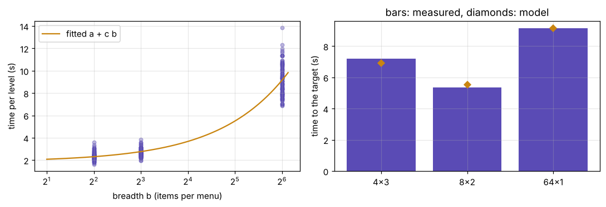
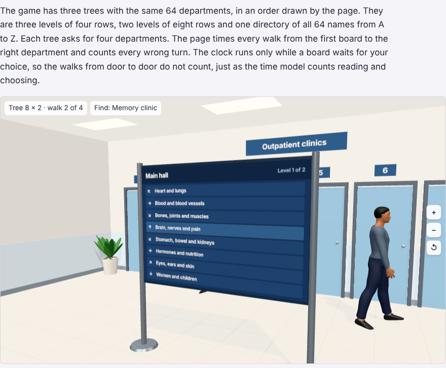

# Week 07: Prototypes and Navigation: Menu Trees, Scent and State Machines

**Human-Computer Interaction (BIL-429 İnsan-Bilgisayar Etkileşimi)**  
Prof. Dr. Utku Kose, Süleyman Demirel University

   

Prototypes and fidelity, the breadth and depth of menu trees, information scent, card sorting and state machines with Markov models. Three games in three dimensions (3D) and a checked prototype of the booking flow complete the week. **Estimated study time:** 8 to 9 hours.

## Materials of the week

Each material has its own role. Start with the lecture page; the study path below gives the order and the time of each step.

| Material | What it holds | Open |
|---|---|---|
| Lecture page | The concepts of the week, with a 3D scene, an animation, discussion questions, an interface clinic, knowledge checks, review cards and the references | [Lecture page](https://utkukose.github.io/human-computer-interaction-NB-lecture/weeks/week-07/lecture.html) |
| Colab notebook | Python step 7: Classes and events, then six hands-on sections that fit the time model of menu trees, estimate information scent, cluster a card sort, check a prototype as a state machine with a Markov model and compute stage 7 of the clinic app, with exercises |  |
| Interactive lab | Prototypes and navigation lab: Five parts, among them three 3D games (the signposts, the card sort and the paper prototype), step-by-step calculators, a self-assessment and an exportable learning log | [Interactive lab](https://utkukose.github.io/human-computer-interaction-NB-lecture/weeks/week-07/lab.html) |
| PDF lecture notes | The Python step and the lecture in one printable file | [PDF notes](Week07_Lecture_Notes.pdf) |

<table><tr><td width="50%"> From the Colab notebook</td><td width="50%"> The interactive lab</td></tr></table>

## Learning outcomes

By the end of the week, students are expected to choose the fidelity of a prototype for a question. They should be able to predict the time of a menu tree from its breadth and depth and find its fastest breadth. They should account for information scent and estimate it from wrong turns. They should also analyse a card sort with similarities and average linkage. Finally, they should be able to describe a prototype as a state machine and check its shortest paths, its traps and the expected actions of a novice. In Python, students are expected to write classes with methods and drive them with events.

## Study path

| Step | Activity | Suggested time |
|---|---|---|
| 1 | Read the [lecture page](https://utkukose.github.io/human-computer-interaction-NB-lecture/weeks/week-07/lecture.html), answer its knowledge checks and think through its discussion questions | 1 hour 45 minutes |
| 2 | Run Python step 7: Classes and events in the [Colab notebook](https://colab.research.google.com/github/utkukose/human-computer-interaction-NB-lecture/blob/main/weeks/week-07/NB07_prototypes_and_navigation.ipynb#scrollTo=python-step), right after the setup section | 1 hour |
| 3 | Play the three games of the [interactive lab](https://utkukose.github.io/human-computer-interaction-NB-lecture/weeks/week-07/lab.html), Parts A, C and D, and work through Parts B and E | 1 hour 30 minutes |
| 4 | Work through Sections 1 to 5 of the Colab notebook with your own results and solve the exercises | 2 hours |
| 5 | Use the application switch of Section 6 and solve the application challenge of your field | 45 minutes |
| 6 | Take the self-assessment in the [interactive lab](https://utkukose.github.io/human-computer-interaction-NB-lecture/weeks/week-07/lab.html) (tab: Check yourself) | 20 minutes |
| 7 | Write the reflection in the interactive lab, export the learning log and complete the weekly task below | 45 minutes |

## Live session plan

The week runs as one synchronous session of about three hours in class or online, and each material has one role in it. The lecture page is on the screen. At each orange Colab box, the instructor shows the matching section in a copy of the Colab notebook that has already been run. Students work in their own copy from top to bottom, and each part of the interactive lab follows the part of the lecture that it practises. The PDF lecture notes serve reading after the session, and the study path above serves self-paced study.

| Time | Activity |
|---|---|
| 0:00 to 0:15 | Opening: The clinic app so far and the question of the week, how to try the redesign before building it. Students open the Colab notebook, save a copy in Drive and run Section 0 |
| 0:15 to 0:35 | Colab, together: Python step 7, ending with a state machine that handles a list of taps |
| 0:35 to 1:05 | Lecture page, part 1: Prototypes and fidelity, then menu trees with the animation, the signposts of Part A and Section 1 |
| 1:05 to 1:25 | Lecture page, part 2: Information scent with Part B and Section 2 |
| 1:25 to 1:35 | Break |
| 1:35 to 2:00 | Lecture page, part 3: Card sorting with the card sort of Part C and Section 3 |
| 2:00 to 2:35 | Lecture page, part 4: State machines with the 3D scene The prototype wall, the paper prototype of Part D and Section 4 |
| 2:35 to 3:00 | Interface clinic and the human side with their discussion questions, the clinic app, stage 7 with Part E and Section 5, and the closing section on Wizard of Oz studies. After the session: Section 6, the self-assessment, the PDF notes and the weekly task |

## Weekly task and submission

**What to do.** First, choose an app or a website with a menu tree of at least three levels and draw its tree. Second, run an open card sort of its main items with three classmates and build the dendrogram with Section 3 of the Colab notebook. Third, propose a broader tree with labels from the card sort and compare both trees with `time_with_errors`, with estimated probabilities. Finally, write its most frequent task as a state machine and check it with `shortest` and `no_way_home`.

**Where to look.** Lecture: Sections "Menu trees: Breadth and depth", "Information scent", "Card sorting" and "State machines and interactive prototypes". Interactive lab: Parts B and D. Colab notebook: Sections 2, 3 and 4, and Exercises B to D.

**Example.** A student draws the menu of a university portal with four levels of six items and $s = 0.85$: $E[T] = 4 \times 1.86/0.85 = 8.75$ s. A broader tree of 12 and 15 items with $s = 0.92$ needs $2.52/0.92 + 2.85/0.92 = 5.84$ s.

**What to submit.** A report of about two pages with both trees, the dendrogram, the computed times and the state machine with its checks. Add the Colab notebook with the exercises of Week 7 completed.

The task is optional and supports self-learning and a personal portfolio. During an active semester, the items listed under What to submit can be sent together with the learning log exported from the interactive lab to utkukose@sdu.edu.tr or utkukose@gmail.com.

## Research and report assignment (optional)

**Card sorting and the navigation it produces** How well do card sorts predict the success of the navigation built from them, as measured by tree tests or usability tests?

**What to do.** Select eight empirical studies published since 2005 that use card sorting to design the navigation of a website or an app. For each study, note the kind of sort, the number of participants, the analysis and how the resulting navigation was evaluated. Compare the findings with the sample sizes of the lecture and with the model of information scent. Then discuss what a team should measure before it trusts a card sort.

**Where to start.** Lecture: Sections "Information scent" and "Card sorting". The references of the lecture page give a first entry to the literature.

**Example focus.** A study may sort the pages of a library website, build two navigations from the results and compare them in a tree test. Note how many tasks each navigation solved without a wrong turn.

The report should be about 1500 words with at least 8 sources, written in the [report template](../../exams/REPORT_TEMPLATE.docx). During an active semester, it can be sent to utkukose@sdu.edu.tr or utkukose@gmail.com.
