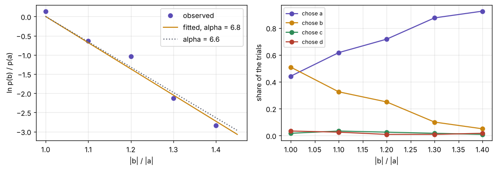
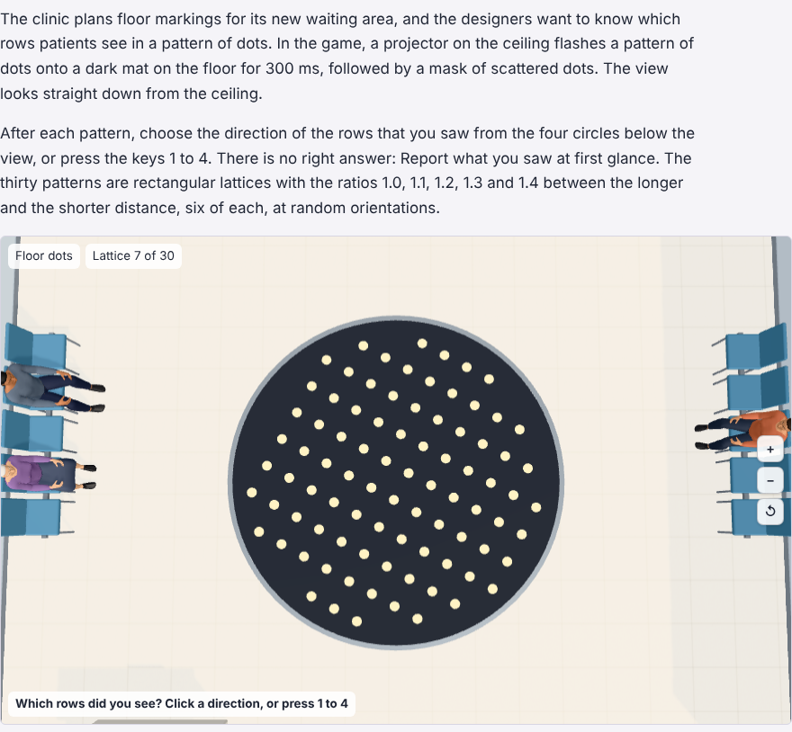

# Week 08: Visual Design and Emotion: Grouping, Layout, First and Last Impressions

**Human-Computer Interaction (BIL-429 İnsan-Bilgisayar Etkileşimi)**  
Prof. Dr. Utku Kose, Süleyman Demirel University

   

Gestalt grouping and the pure distance law, balance and alignment, heat maps, first impressions with colourfulness and complexity, and the peak-end rule of remembered experience. Three experiments in three dimensions (3D) and redesigned screens of the clinic app complete the week. **Estimated study time:** 8 to 9 hours.

## Materials of the week

Each material has its own role. Start with the lecture page; the study path below gives the order and the time of each step.

| Material | What it holds | Open |
|---|---|---|
| Lecture page | The concepts of the week, with a 3D scene, an animation, discussion questions, an interface clinic, knowledge checks, review cards and the references | [Lecture page](https://utkukose.github.io/human-computer-interaction-NB-lecture/weeks/week-08/lecture.html) |
| Colab notebook | Python step 8: Images as arrays, then six hands-on sections that fit the pure distance law, compute balance, edges and heat maps, rebuild twelve designs with their colourfulness and edge density, test the peak-end rule and compute stage 8 of the clinic app, with exercises |  |
| Interactive lab | Visual design and emotion lab: Five parts, among them three 3D experiments (the floor dots, the fifty-millisecond test and the waits at the kiosk), step-by-step calculators, a self-assessment and an exportable learning log | [Interactive lab](https://utkukose.github.io/human-computer-interaction-NB-lecture/weeks/week-08/lab.html) |
| PDF lecture notes | The Python step and the lecture in one printable file | [PDF notes](Week08_Lecture_Notes.pdf) |

<table><tr><td width="50%"> From the Colab notebook</td><td width="50%"> The interactive lab</td></tr></table>

## Learning outcomes

By the end of the week, students are expected to explain the Gestalt principles of grouping and to predict grouping by proximity with the pure distance law. They should be able to compute the balance of a layout, count its alignment points and build a heat map from fixations. They should also compute the colourfulness and the edge density of a design and relate them to first impressions. Finally, they should be able to discuss the relation of beauty and usability and apply the peak-end rule to the waits of an interaction. In Python, students are expected to handle images as arrays with NumPy.

## Study path

| Step | Activity | Suggested time |
|---|---|---|
| 1 | Read the [lecture page](https://utkukose.github.io/human-computer-interaction-NB-lecture/weeks/week-08/lecture.html), answer its knowledge checks and think through its discussion questions | 1 hour 45 minutes |
| 2 | Run Python step 8: Images as arrays in the [Colab notebook](https://colab.research.google.com/github/utkukose/human-computer-interaction-NB-lecture/blob/main/weeks/week-08/NB08_visual_design_and_emotion.ipynb#scrollTo=python-step), right after the setup section | 1 hour |
| 3 | Play the three experiments of the [interactive lab](https://utkukose.github.io/human-computer-interaction-NB-lecture/weeks/week-08/lab.html), Parts A, C and D, and work through Parts B and E | 1 hour 30 minutes |
| 4 | Work through Sections 1 to 5 of the Colab notebook with your own results and solve the exercises | 2 hours |
| 5 | Use the application switch of Section 6 and solve the application challenge of your field | 45 minutes |
| 6 | Take the self-assessment in the [interactive lab](https://utkukose.github.io/human-computer-interaction-NB-lecture/weeks/week-08/lab.html) (tab: Check yourself) | 20 minutes |
| 7 | Write the reflection in the interactive lab, export the learning log and complete the weekly task below | 45 minutes |

## Live session plan

The week runs as one synchronous session of about three hours in class or online, and each material has one role in it. The lecture page is on the screen. At each orange Colab box, the instructor shows the matching section in a copy of the Colab notebook that has already been run. Students work in their own copy from top to bottom, and each part of the interactive lab follows the part of the lecture that it practises. The PDF lecture notes serve reading after the session, and the study path above serves self-paced study.

| Time | Activity |
|---|---|
| 0:00 to 0:15 | Opening: The clinic app so far and the question of the week, how the redesign should look and feel. Students open the Colab notebook, save a copy in Drive and run Section 0 |
| 0:15 to 0:35 | Colab, together: Python step 8, ending with statistics of a small screen drawn as an array |
| 0:35 to 1:00 | Lecture page, part 1: Gestalt and the pure distance law with the animation, the floor dots of Part A and Section 1 |
| 1:00 to 1:25 | Lecture page, part 2: Balance, alignment and heat maps with the 3D scene Eyes on the display, Part B and Section 2 |
| 1:25 to 1:35 | Break |
| 1:35 to 2:00 | Lecture page, part 3: First impressions with the fifty-millisecond test of Part C and Section 3 |
| 2:00 to 2:35 | Lecture page, part 4: Beauty, usability and the peak-end rule with the waits of Part D and Section 4 |
| 2:35 to 3:00 | Interface clinic and the human side with their discussion questions, the clinic app, stage 8 with Part E and Section 5, and the closing section on emotions read from faces. After the session: Section 6, the self-assessment, the PDF notes and the weekly task |

## Weekly task and submission

**What to do.** First, take screenshots of two screens of an app that you use, one that you like and one that you do not. Describe their main elements as rectangles. Second, compute their balance, their distinct edges, their colourfulness and their edge density with Sections 2 and 3 of the Colab notebook. Third, measure the waits after each step of one task in the app and compute their peak-end value. Finally, propose a redesign of the weaker screen and an order of the waits with a better end.

**Where to look.** Lecture: Sections "Layout: Balance, alignment and where the eye lands", "First impressions in fifty milliseconds" and "Emotion: Beauty, usability and the remembered experience". Interactive lab: Parts B and D. Colab notebook: Sections 2, 3 and 4, and Exercises B to D.

**Example.** A student compares the start screens of two banking apps: Balance 0.62 and 0.88, colourfulness 74 and 31. The transfer in the first app waits 0.3, 0.3, 0.4, 0.3 and 4.5 s, a peak-end value of 4.50 s. A redesign that checks the account first reaches 2.40 s.

**What to submit.** A report of about two pages with both screens, the computed measures, the waits with their peak-end values and the redesign. Add the Colab notebook with the exercises of Week 8 completed.

The task is optional and supports self-learning and a personal portfolio. During an active semester, the items listed under What to submit can be sent together with the learning log exported from the interactive lab to utkukose@sdu.edu.tr or utkukose@gmail.com.

## Research and report assignment (optional)

**Computational aesthetics of user interfaces** How well do computed measures of layout, colour and complexity predict how people judge the beauty and the usability of user interfaces?

**What to do.** Select eight empirical studies published since 2005 that compute measures of interface aesthetics, such as balance, colourfulness or visual complexity. Each study should compare its measures with the ratings of people. For each study, note the measures, the interfaces, the number of participants and how well the measures predicted the ratings. Compare the findings with the measures of the lecture. Then discuss what such measures can and cannot replace in a usability test.

**Where to start.** Lecture: Sections "Layout: Balance, alignment and where the eye lands" and "First impressions in fifty milliseconds". The references of the lecture page give a first entry to the literature.

**Example focus.** A study may compute colourfulness and complexity for hundreds of websites and correlate them with first impressions. Note how much of the variation in the ratings the measures explained.

The report should be about 1500 words with at least 8 sources, written in the [report template](../../exams/REPORT_TEMPLATE.docx). During an active semester, it can be sent to utkukose@sdu.edu.tr or utkukose@gmail.com.
