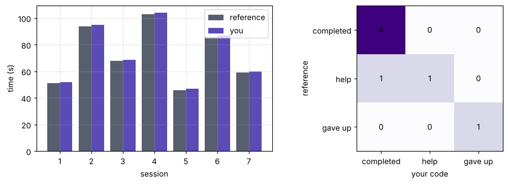
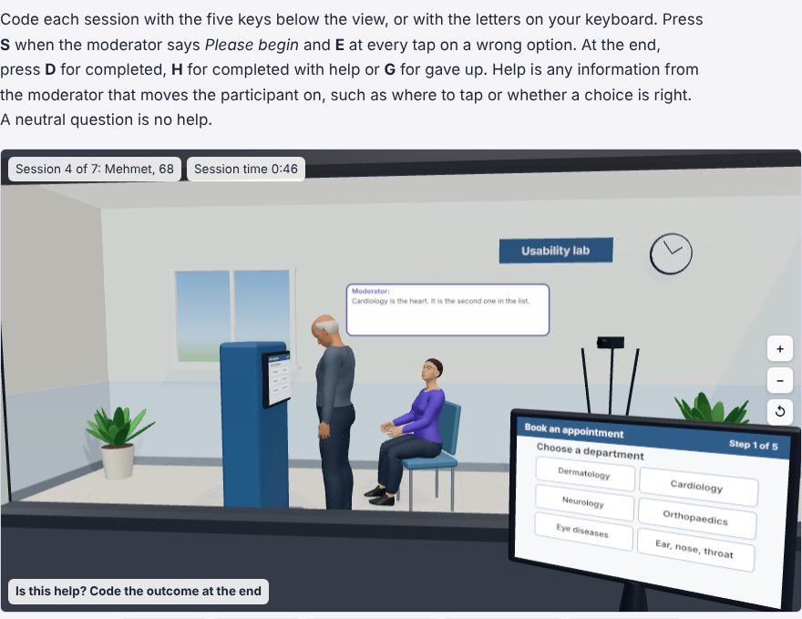

# Week 09: Usability Testing: Observing People and Measuring with Confidence

**Human-Computer Interaction (BIL-429 İnsan-Bilgisayar Etkileşimi)**  
Prof. Dr. Utku Kose, Süleyman Demirel University

   

Think-aloud sessions coded with Cohen's kappa, completion rates with adjusted Wald intervals, skewed task times and the geometric mean, recruiting and sample sizes, and A/B tests without peeking. Three experiments in three dimensions (3D) and a usability test of both designs of the clinic app complete the week. **Estimated study time:** 8 to 9 hours.

## Materials of the week

Each material has its own role. Start with the lecture page; the study path below gives the order and the time of each step.

| Material | What it holds | Open |
|---|---|---|
| Lecture page | The concepts of the week, with a 3D scene, an animation, discussion questions, an interface clinic, knowledge checks, review cards and the references | [Lecture page](https://utkukose.github.io/human-computer-interaction-NB-lecture/weeks/week-09/lecture.html) |
| Colab notebook | Python step 9: Distributions and tests with SciPy, then seven hands-on sections that compute Cohen's kappa of your coding, adjusted Wald intervals and their coverage, geometric means and Welch's test, weighted rates and sample sizes, A/B tests with the price of peeking and stage 9 of the clinic app, with exercises |  |
| Interactive lab | Usability testing lab: Five parts, among them three 3D games (the observation room, the recruiting desk and two kiosks with A/B tests), step-by-step calculators, a self-assessment and an exportable learning log | [Interactive lab](https://utkukose.github.io/human-computer-interaction-NB-lecture/weeks/week-09/lab.html) |
| PDF lecture notes | The Python step and the lecture in one printable file | [PDF notes](Week09_Lecture_Notes.pdf) |

<table><tr><td width="50%"> From the Colab notebook</td><td width="50%"> The interactive lab</td></tr></table>

## Learning outcomes

By the end of the week, students are expected to plan a usability test with tasks, thinking aloud and coding rules. They should measure the agreement of two observers with Cohen's kappa and be able to compute adjusted Wald intervals for completion rates and geometric means with intervals for task times. They should also compare two designs with the N-1 test and Welch's test and plan the number of participants. Finally, they should be able to explain why recruiting, peeking and response bias can mislead a test. In Python, students are expected to use the distributions and tests of SciPy.

## Study path

| Step | Activity | Suggested time |
|---|---|---|
| 1 | Read the [lecture page](https://utkukose.github.io/human-computer-interaction-NB-lecture/weeks/week-09/lecture.html), answer its knowledge checks and think through its discussion questions | 1 hour 45 minutes |
| 2 | Run Python step 9: Distributions and tests with SciPy in the [Colab notebook](https://colab.research.google.com/github/utkukose/human-computer-interaction-NB-lecture/blob/main/weeks/week-09/NB09_usability_testing.ipynb#scrollTo=python-step), right after the setup section | 1 hour |
| 3 | Play the three games of the [interactive lab](https://utkukose.github.io/human-computer-interaction-NB-lecture/weeks/week-09/lab.html), Parts A, C and D, and work through Parts B and E | 1 hour 30 minutes |
| 4 | Work through Sections 1 to 6 of the Colab notebook with your own results and solve the exercises | 2 hours |
| 5 | Use the application switch of Section 7 and solve the application challenge of your field | 45 minutes |
| 6 | Take the self-assessment in the [interactive lab](https://utkukose.github.io/human-computer-interaction-NB-lecture/weeks/week-09/lab.html) (tab: Check yourself) | 20 minutes |
| 7 | Write the reflection in the interactive lab, export the learning log and complete the weekly task below | 45 minutes |

## Live session plan

The week runs as one synchronous session of about three hours in class or online, and each material has one role in it. The lecture page is on the screen. At each orange Colab box, the instructor shows the matching section in a copy of the Colab notebook that has already been run. Students work in their own copy from top to bottom, and each part of the interactive lab follows the part of the lecture that it practises. The PDF lecture notes serve reading after the session, and the study path above serves self-paced study.

| Time | Activity |
|---|---|
| 0:00 to 0:15 | Opening: The clinic app so far and the question of the week, whether the redesign really helps patients. Students open the Colab notebook, save a copy in Drive and run Section 0 |
| 0:15 to 0:35 | Colab, together: Python step 9, ending with a first Welch test |
| 0:35 to 1:00 | Lecture page, part 1: The test session and Cohen's kappa, with the observation room of Part A and Section 1 |
| 1:00 to 1:25 | Lecture page, part 2: Completion rates and task times with the 3D scene The same test, run again, the animation of skewed times, Part B and Sections 2 and 3 |
| 1:25 to 1:35 | Break |
| 1:35 to 2:00 | Lecture page, part 3: Recruiting and sample sizes with the recruiting desk of Part C and Section 4 |
| 2:00 to 2:30 | Lecture page, part 4: A/B tests, power and peeking with the two kiosks of Part D and Section 5 |
| 2:30 to 3:00 | Interface clinic and the human side with their discussion questions, the clinic app, stage 9 with Part E and Section 6, and the closing section on assistants that analyse sessions. After the session: Section 7, the self-assessment, the PDF notes and the weekly task |

## Weekly task and submission

**What to do.** First, choose one task of an app that you use and write its coding rules. They state when the task counts as completed, completed with help or given up, and what an error is. Second, test the task with five classmates who think aloud, and code the sessions together with a partner. Third, compute your kappa, the completion rate with its adjusted Wald interval and the geometric mean time with its interval in the Colab notebook. Finally, plan a summative test: How many participants would an interval of $\pm 0.10$ need?

**Where to look.** Lecture: Sections "The test session: Tasks, thinking aloud and coding", "Completion rates with confidence", "Time on task: Skewed times and the geometric mean" and "Who takes part, and how many". Interactive lab: Parts A and B. Colab notebook: Sections 1 to 4, and Exercises A to D.

**Example.** A student tests the checkout of a food delivery app with five classmates. Three of five complete without help, an interval of 0.23 to 0.88, and the two observers reach a kappa of 0.69. The geometric mean time is 74 s, and an interval of $\pm 0.10$ would need 89 participants.

**What to submit.** A report of about two pages with the coding rules, the codes of both observers, the measures with their intervals and the plan of the summative test. Add the Colab notebook with the exercises of Week 9 completed.

The task is optional and supports self-learning and a personal portfolio. During an active semester, the items listed under What to submit can be sent together with the learning log exported from the interactive lab to utkukose@sdu.edu.tr or utkukose@gmail.com.

## Research and report assignment (optional)

**How many participants? Sample sizes in usability testing** How many participants do usability tests need to find problems and to measure usability, according to empirical studies?

**What to do.** Select eight empirical studies published since 2000 on the number of participants in usability tests. Include studies on the discovery of problems and studies on measures such as completion rates or task times. For each study, note the method, the number of participants, the main finding and its limits. Compare the findings with the formulas of the lecture. Then write recommendations for a team that plans a formative and a summative test of the same app.

**Where to start.** Lecture: Sections "Completion rates with confidence" and "Who takes part, and how many". The references of the lecture page give a first entry to the literature.

**Example focus.** A study may draw random sets of participants from a large test and count the problems that each set finds. Note the smallest and the largest share of problems found by sets of the same size.

The report should be about 1500 words with at least 8 sources, written in the [report template](../../exams/REPORT_TEMPLATE.docx). During an active semester, it can be sent to utkukose@sdu.edu.tr or utkukose@gmail.com.
