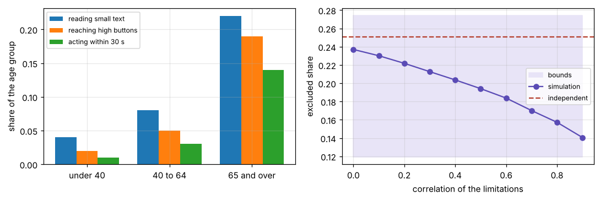
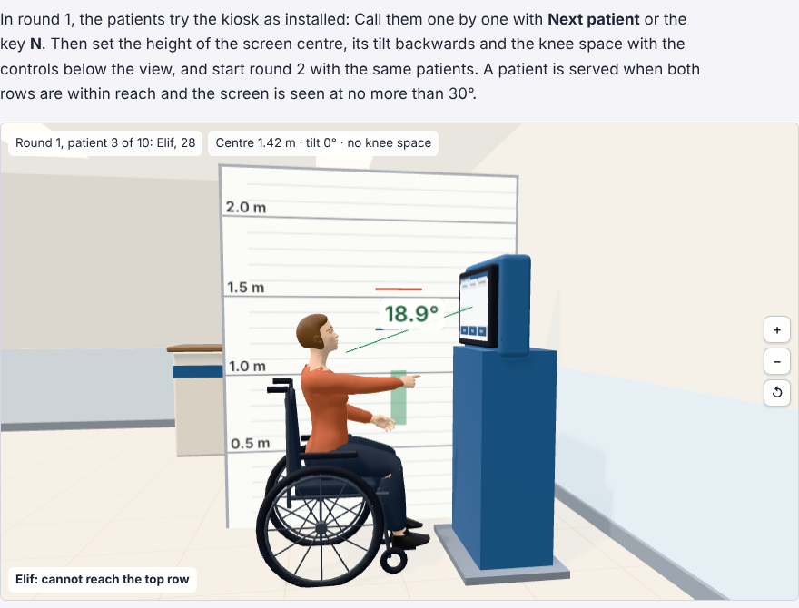

# Week 10: Accessibility and Inclusive Design

**Human-Computer Interaction (BIL-429 İnsan-Bilgisayar Etkileşimi)**  
Prof. Dr. Utku Kose, Süleyman Demirel University

   

Disability as a mismatch, the success criteria of the Web Content Accessibility Guidelines (WCAG) 2.2, reach and sight lines at the kiosk, reading levels and screen readers. Three experiments in three dimensions (3D) and an accessibility audit of the clinic app complete the week. **Estimated study time:** 8 to 9 hours.

## Materials of the week

Each material has its own role. Start with the lecture page; the study path below gives the order and the time of each step.

| Material | What it holds | Open |
|---|---|---|
| Lecture page | The concepts of the week, with a 3D scene, an animation, discussion questions, an interface clinic, knowledge checks, review cards and the references | [Lecture page](https://utkukose.github.io/human-computer-interaction-NB-lecture/weeks/week-10/lecture.html) |
| Colab notebook | Python step 10: Text with regular expressions, then seven hands-on sections that compute the exclusion of overlapping limitations, an audit against WCAG 2.2, the reach and sight lines of the kiosk, readability in English and Turkish, the navigation cost of a screen reader and stage 10 of the clinic app, with exercises |  |
| Interactive lab | Accessibility lab: Five parts, among them three 3D games (the kiosk for everyone, plain words at the kiosk and listening to the kiosk), step-by-step calculators, a self-assessment and an exportable learning log | [Interactive lab](https://utkukose.github.io/human-computer-interaction-NB-lecture/weeks/week-10/lab.html) |
| PDF lecture notes | The Python step and the lecture in one printable file | [PDF notes](Week10_Lecture_Notes.pdf) |

<table><tr><td width="50%"> From the Colab notebook</td><td width="50%"> The interactive lab</td></tr></table>

## Learning outcomes

By the end of the week, students are expected to explain disability as a mismatch between people and a design and to estimate how many people a design excludes. They should be able to audit an interface against the success criteria of WCAG 2.2 and to explain what automated tools miss. They should also compute the reach of controls, the viewing angle of a screen and the reading level of a text in English and Turkish. Finally, they should be able to model the navigation cost of a screen-reader user. In Python, students are expected to handle text with string methods and regular expressions.

## Study path

| Step | Activity | Suggested time |
|---|---|---|
| 1 | Read the [lecture page](https://utkukose.github.io/human-computer-interaction-NB-lecture/weeks/week-10/lecture.html), answer its knowledge checks and think through its discussion questions | 1 hour 45 minutes |
| 2 | Run Python step 10: Text with regular expressions in the [Colab notebook](https://colab.research.google.com/github/utkukose/human-computer-interaction-NB-lecture/blob/main/weeks/week-10/NB10_accessibility.ipynb#scrollTo=python-step), right after the setup section | 1 hour |
| 3 | Play the three games of the [interactive lab](https://utkukose.github.io/human-computer-interaction-NB-lecture/weeks/week-10/lab.html), Parts A, C and D, and work through Parts B and E | 1 hour 30 minutes |
| 4 | Work through Sections 1 to 6 of the Colab notebook with your own results and solve the exercises | 2 hours |
| 5 | Use the application switch of Section 7 and solve the application challenge of your field | 45 minutes |
| 6 | Take the self-assessment in the [interactive lab](https://utkukose.github.io/human-computer-interaction-NB-lecture/weeks/week-10/lab.html) (tab: Check yourself) | 20 minutes |
| 7 | Write the reflection in the interactive lab, export the learning log and complete the weekly task below | 45 minutes |

## Live session plan

The week runs as one synchronous session of about three hours in class or online, and each material has one role in it. The lecture page is on the screen. At each orange Colab box, the instructor shows the matching section in a copy of the Colab notebook that has already been run. Students work in their own copy from top to bottom, and each part of the interactive lab follows the part of the lecture that it practises. The PDF lecture notes serve reading after the session, and the study path above serves self-paced study.

| Time | Activity |
|---|---|
| 0:00 to 0:15 | Opening: The clinic app so far and the question of the week, who cannot use the app at all. Students open the Colab notebook, save a copy in Drive and run Section 0 |
| 0:15 to 0:35 | Colab, together: Python step 10, ending with the syllables of a Turkish word |
| 0:35 to 1:00 | Lecture page, part 1: Who is excluded, with the 3D scene One kiosk, nine barriers, and WCAG 2.2, with Sections 1 and 2 |
| 1:00 to 1:25 | Lecture page, part 2: Reach and sight at the kiosk, with the kiosk of Part A and Section 3 |
| 1:25 to 1:35 | Break |
| 1:35 to 2:00 | Lecture page, part 3: Plain words, with Parts B and C and Section 4 |
| 2:00 to 2:30 | Lecture page, part 4: Screen readers, with the animation of the navigation cost, Part D and Section 5 |
| 2:30 to 3:00 | Interface clinic and the human side with their discussion questions, the clinic app, stage 10 with Part E and Section 6, and the closing section on automatic image descriptions. After the session: Section 7, the self-assessment, the PDF notes and the weekly task |

## Weekly task and submission

**What to do.** First, choose an app or a website that you use and audit one task against ten success criteria of WCAG 2.2 that you select. Second, use it with the screen reader of your phone or computer and count the presses that the task needs. Third, compute the grade level of its longest message in the Colab notebook and rewrite the message in plain words. Finally, estimate how many people the barriers that you found exclude, with the formula and the bounds of the lecture.

**Where to look.** Lecture: Sections "Who is excluded: Disability as a mismatch", "WCAG 2.2: Four principles and testable criteria", "Plain words: Reading level and readability" and "Screen readers, focus order and the keyboard". Interactive lab: Parts B and D. Colab notebook: Sections 1, 2, 4 and 5, and Exercises A to E.

**Example.** A student audits the checkout of a food delivery app. Three of ten criteria fail, among them two icon buttons without names. The task needs 31 presses with the screen reader, and the error message falls from grade 11.4 to grade 5.2 after rewriting.

**What to submit.** A report of about two pages with the audit table, the count of presses, both versions of the message with their grades and the estimate of exclusion. Add the Colab notebook with the exercises of Week 10 completed.

The task is optional and supports self-learning and a personal portfolio. During an active semester, the items listed under What to submit can be sent together with the learning log exported from the interactive lab to utkukose@sdu.edu.tr or utkukose@gmail.com.

## Research and report assignment (optional)

**Automated accessibility testing: What tools find and what they miss** How much of the accessibility of a website can automated tools evaluate, according to empirical studies?

**What to do.** Select eight empirical studies published since 2010 that compare automated accessibility tools with experts or with tests by disabled users. For each study, note the tools, the pages, the criteria, the share of problems found and the false alarms. Compare the findings across studies and with the success criteria of WCAG 2.2. Then write recommendations for a team that audits an app with a small budget.

**Where to start.** Lecture: Sections "WCAG 2.2: Four principles and testable criteria" and "The clinic app, stage 10". The references of the lecture page give a first entry to the literature.

**Example focus.** A study may run six tools on the same pages that experts audited and count how many of the experts' violations each tool reports. Note the share found and the share of tool reports that were wrong.

The report should be about 1500 words with at least 8 sources, written in the [report template](../../exams/REPORT_TEMPLATE.docx). During an active semester, it can be sent to utkukose@sdu.edu.tr or utkukose@gmail.com.
