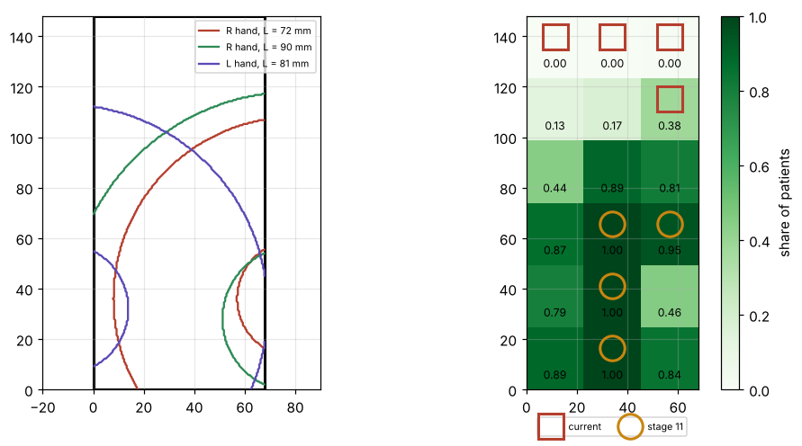
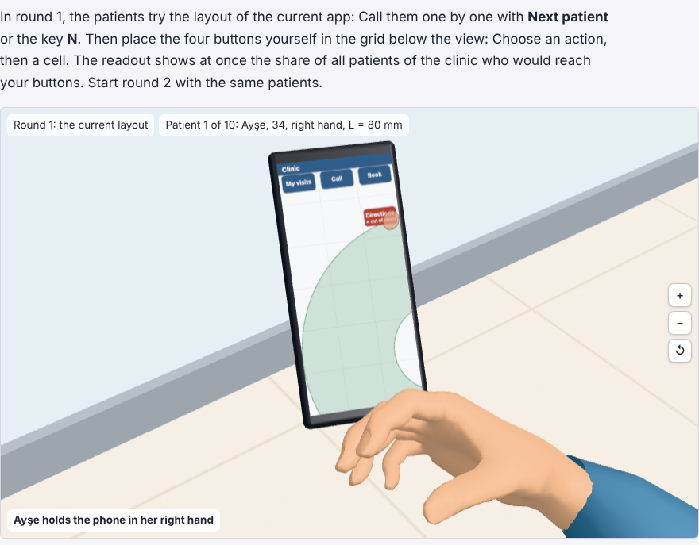

# Week 11: Mobile, Multimodal and Ubiquitous Interaction

**Human-Computer Interaction (BIL-429 İnsan-Bilgisayar Etkileşimi)**  
Prof. Dr. Utku Kose, Süleyman Demirel University

   

The reach of the thumb, gestures and their recognition, typing on glass, speech and its errors, and notifications that interrupt. Three experiments in three dimensions (3D) and a waiting room of the clinic take the app onto the phone and add voice. **Estimated study time:** 8 to 9 hours.

## Materials of the week

Each material has its own role. Start with the lecture page; the study path below gives the order and the time of each step.

| Material | What it holds | Open |
|---|---|---|
| Lecture page | The concepts of the week, with a 3D scene, an animation, discussion questions, an interface clinic, knowledge checks, review cards and the references | [Lecture page](https://utkukose.github.io/human-computer-interaction-NB-lecture/weeks/week-11/lecture.html) |
| Colab notebook | Python step 11: Points and paths with NumPy, then seven hands-on sections that compute the reach of the thumb, build the \$1 gesture recognizer, measure text entry and the word error rate, model notifications and compute stage 11 of the clinic app, with exercises |  |
| Interactive lab | Mobile and multimodal lab: Five parts, among them three 3D games (one hand on the phone, gestures on the tablet and typing in the waiting room), step-by-step calculators, a self-assessment and an exportable learning log | [Interactive lab](https://utkukose.github.io/human-computer-interaction-NB-lecture/weeks/week-11/lab.html) |
| PDF lecture notes | The Python step and the lecture in one printable file | [PDF notes](Week11_Lecture_Notes.pdf) |

<table><tr><td width="50%"> From the Colab notebook</td><td width="50%"> The interactive lab</td></tr></table>

## Learning outcomes

By the end of the week, students are expected to explain the functional area of the thumb and to place the main actions of a mobile app within its reach. They should be able to explain and implement the four steps of the \$1 gesture recognizer. They should also measure text entry by its speed, its minimum string distance and its keystrokes per character, and speech by its word error rate. Finally, they should be able to model notifications as random arrivals and to judge when context should change what an app shows. In Python, students are expected to handle points and paths as NumPy arrays.

## Study path

| Step | Activity | Suggested time |
|---|---|---|
| 1 | Read the [lecture page](https://utkukose.github.io/human-computer-interaction-NB-lecture/weeks/week-11/lecture.html), answer its knowledge checks and think through its discussion questions | 1 hour 45 minutes |
| 2 | Run Python step 11: Points and paths with NumPy in the [Colab notebook](https://colab.research.google.com/github/utkukose/human-computer-interaction-NB-lecture/blob/main/weeks/week-11/NB11_mobile_and_multimodal.ipynb#scrollTo=python-step), right after the setup section | 1 hour |
| 3 | Play the three games of the [interactive lab](https://utkukose.github.io/human-computer-interaction-NB-lecture/weeks/week-11/lab.html), Parts A, C and D, and work through Parts B and E | 1 hour 30 minutes |
| 4 | Work through Sections 1 to 6 of the Colab notebook with your own results and solve the exercises | 2 hours |
| 5 | Use the application switch of Section 7 and solve the application challenge of your field | 45 minutes |
| 6 | Take the self-assessment in the [interactive lab](https://utkukose.github.io/human-computer-interaction-NB-lecture/weeks/week-11/lab.html) (tab: Check yourself) | 20 minutes |
| 7 | Write the reflection in the interactive lab, export the learning log and complete the weekly task below | 45 minutes |

## Live session plan

The week runs as one synchronous session of about three hours in class or online, and each material has one role in it. The lecture page is on the screen. At each orange Colab box, the instructor shows the matching section in a copy of the Colab notebook that has already been run. Students work in their own copy from top to bottom, and each part of the interactive lab follows the part of the lecture that it practises. The PDF lecture notes serve reading after the session, and the study path above serves self-paced study.

| Time | Activity |
|---|---|
| 0:00 to 0:15 | Opening: The clinic app so far and the question of the week, the app in one hand on the move. Students open the Colab notebook, save a copy in Drive and run Section 0 |
| 0:15 to 0:35 | Colab, together: Python step 11, ending with a stroke turned by 90 degrees |
| 0:35 to 1:00 | Lecture page, part 1: Phones in the hand, with the thumbs of Part A and Section 1 |
| 1:00 to 1:30 | Lecture page, part 2: Gestures, with the calculator of Part B, the tablet of Part C and Section 2 |
| 1:30 to 1:40 | Break |
| 1:40 to 2:05 | Lecture page, part 3: Typing on glass, with the animation of the edit distance, Part D and Section 3 |
| 2:05 to 2:30 | Lecture page, part 4: Speech and multimodal input with Section 4, and notifications with the 3D scene Called while looking down and Section 5 |
| 2:30 to 3:00 | Interface clinic and the human side with their discussion questions, the clinic app, stage 11 with Part E and Section 6, and the closing section on voice assistants. After the session: Section 7, the self-assessment, the PDF notes and the weekly task |

## Weekly task and submission

**What to do.** First, measure where the main actions of a mobile app that you use lie on its screen. Check with the model of the week which thumbs reach them. Second, type five phrases of the course on your own phone, sitting and walking, and compute your speed, error rate and keystrokes per character. Third, dictate the same phrases to the speech recognition of your phone and compute the word error rate. Finally, count your notifications for one day and estimate how often they interrupt a task of three minutes.

**Where to look.** Lecture: Sections "Phones in the hand: Grips and the reach of the thumb", "Typing on glass: Text entry speed and errors", "Talking to the app: Speech and multimodal input" and "Notifications, interruptions and context". Interactive lab: Parts A and D. Colab notebook: Sections 1, 3, 4 and 5, and Exercises A, C, D and E.

**Example.** A student finds the cart button of a shopping app in the top right corner, which no thumb reaches in the model. Sitting, the student types 38 words per minute (WPM) with an error rate of 1.2 percent, and walking 29 WPM with 4.0 percent. Dictation reaches a word error rate (WER) of 0.06, and 71 notifications in a day interrupt about one task of three minutes in five.

**What to submit.** A report of about two pages with the screen and its reach, the table of your typing and dictation, and the count and model of your notifications. Add the Colab notebook with the exercises of Week 11 completed.

The task is optional and supports self-learning and a personal portfolio. During an active semester, the items listed under What to submit can be sent together with the learning log exported from the interactive lab to utkukose@sdu.edu.tr or utkukose@gmail.com.

## Research and report assignment (optional)

**Situational impairments: Phones used while walking, carrying and distracted** How do walking, carrying objects and divided attention change the performance of touch input on phones, according to empirical studies?

**What to do.** Select eight empirical studies published since 2008 that measure touch input or text entry on phones while walking, while carrying objects or while distracted. For each study, note the tasks, the conditions, the participants and the measures of speed and accuracy. Compare the size of the effects across the studies, and summarise which designs reduced them. Then write recommendations for a hospital app that patients use on the move.

**Where to start.** Lecture: Sections "Phones in the hand: Grips and the reach of the thumb" and "Typing on glass: Text entry speed and errors". The references of the lecture page give a first entry to the literature.

**Example focus.** A study may compare targeting with a bag in each hand to targeting without bags, as Ng and colleagues did. It may report the error in millimetres for each posture.

The report should be about 1500 words with at least 8 sources, written in the [report template](../../exams/REPORT_TEMPLATE.docx). During an active semester, it can be sent to utkukose@sdu.edu.tr or utkukose@gmail.com.
