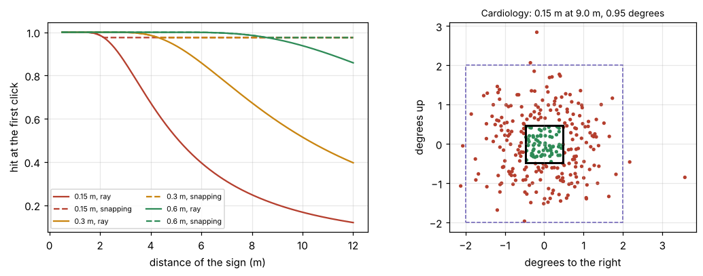
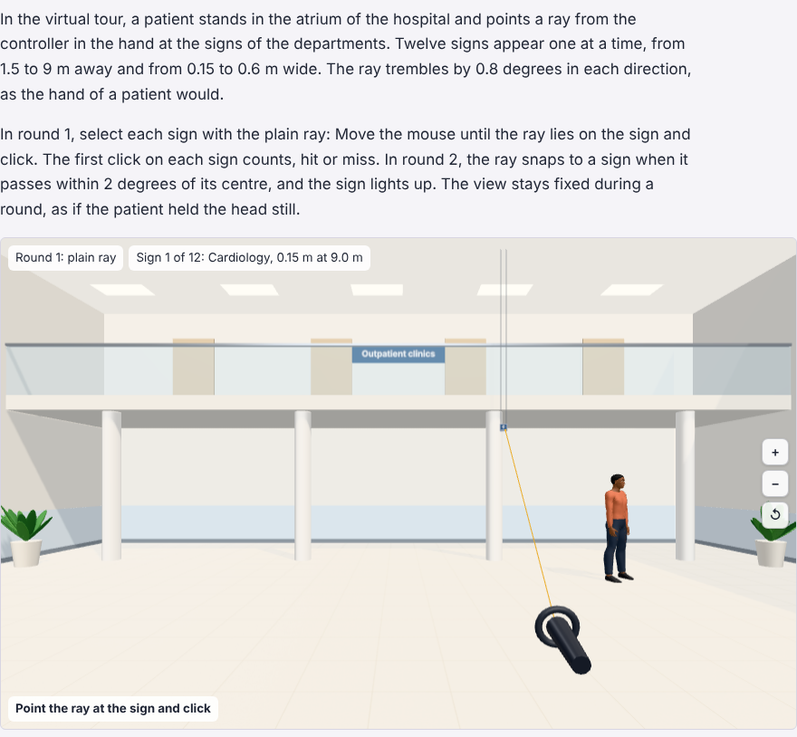

# Week 12: 3D User Interfaces, Virtual and Augmented Reality

**Human-Computer Interaction (BIL-429 İnsan-Bilgisayar Etkileşimi)**  
Prof. Dr. Utku Kose, Süleyman Demirel University

   

Selecting at a distance with a ray and a virtual hand, travel and the sickness it can cause, presence, and arrows of augmented reality that drift. Three games in three dimensions (3D) and a corridor that turns virtual take the clinic app into the building. **Estimated study time:** 8 to 9 hours.

## Materials of the week

Each material has its own role. Start with the lecture page; the study path below gives the order and the time of each step.

| Material | What it holds | Open |
|---|---|---|
| Lecture page | The concepts of the week, with a 3D scene, an animation, discussion questions, an interface clinic, knowledge checks, review cards and the references | [Lecture page](https://utkukose.github.io/human-computer-interaction-NB-lecture/weeks/week-12/lecture.html) |
| Colab notebook | Python step 12: Vectors in three dimensions, then seven hands-on sections that compute the hit probability of a ray, the Go-Go mapping, the time of travel and a pointing error, the scores of the Simulator Sickness Questionnaire, the drift of arrows in augmented reality and stage 12 of the clinic app, with exercises |  |
| Interactive lab | 3D interfaces lab: Five parts, among them three 3D games (signs at a distance, a tour through the virtual hospital and arrows in the corridor), step-by-step calculators, a self-assessment and an exportable learning log | [Interactive lab](https://utkukose.github.io/human-computer-interaction-NB-lecture/weeks/week-12/lab.html) |
| PDF lecture notes | The Python step and the lecture in one printable file | [PDF notes](Week12_Lecture_Notes.pdf) |

<table><tr><td width="50%"> From the Colab notebook</td><td width="50%"> The interactive lab</td></tr></table>

## Learning outcomes

By the end of the week, students are expected to place an interface on the reality-virtuality continuum and to distinguish immersion from presence. They should be able to compute the hit probability of a ray from the angular width of a target, and the reach and the gain of the Go-Go technique. They should also compare steering and teleporting by time, visual motion and disorientation, and score the Simulator Sickness Questionnaire. Finally, they should be able to model the drift of arrows in augmented reality and the effect of anchors. In Python, students are expected to work with vectors in three dimensions.

## Study path

| Step | Activity | Suggested time |
|---|---|---|
| 1 | Read the [lecture page](https://utkukose.github.io/human-computer-interaction-NB-lecture/weeks/week-12/lecture.html), answer its knowledge checks and think through its discussion questions | 1 hour 45 minutes |
| 2 | Run Python step 12: Vectors in three dimensions in the [Colab notebook](https://colab.research.google.com/github/utkukose/human-computer-interaction-NB-lecture/blob/main/weeks/week-12/NB12_3d_ui_vr_ar.ipynb#scrollTo=python-step), right after the setup section | 1 hour |
| 3 | Play the three games of the [interactive lab](https://utkukose.github.io/human-computer-interaction-NB-lecture/weeks/week-12/lab.html), Parts A, C and D, and work through Parts B and E | 1 hour 30 minutes |
| 4 | Work through Sections 1 to 6 of the Colab notebook with your own results and solve the exercises | 2 hours |
| 5 | Use the application switch of Section 7 and solve the application challenge of your field | 45 minutes |
| 6 | Take the self-assessment in the [interactive lab](https://utkukose.github.io/human-computer-interaction-NB-lecture/weeks/week-12/lab.html) (tab: Check yourself) | 20 minutes |
| 7 | Write the reflection in the interactive lab, export the learning log and complete the weekly task below | 45 minutes |

## Live session plan

The week runs as one synchronous session of about three hours in class or online, and each material has one role in it. The lecture page is on the screen. At each orange Colab box, the instructor shows the matching section in a copy of the Colab notebook that has already been run. Students work in their own copy from top to bottom, and each part of the interactive lab follows the part of the lecture that it practises. The PDF lecture notes serve reading after the session, and the study path above serves self-paced study.

| Time | Activity |
|---|---|
| 0:00 to 0:15 | Opening: The clinic app so far and the question of the week, a hospital in three dimensions. Students open the Colab notebook, save a copy in Drive and run Section 0 |
| 0:15 to 0:35 | Colab, together: Python step 12, ending with a ray that meets a plane |
| 0:35 to 1:05 | Lecture page, part 1: The reality-virtuality continuum with the 3D scene From the corridor to a virtual world, then pointing with a ray with Part A, the first calculator of Part B and Section 1 |
| 1:05 to 1:25 | Lecture page, part 2: The Go-Go technique with the animation, the second calculator of Part B and Section 2 |
| 1:25 to 1:35 | Break |
| 1:35 to 2:00 | Lecture page, part 3: Travel with Part C and Section 3, then presence and cybersickness with Section 4 |
| 2:00 to 2:30 | Lecture page, part 4: Augmented reality in the corridor with Part D and Section 5 |
| 2:30 to 3:00 | Interface clinic and the human side with their discussion questions, the clinic app, stage 12 with Part E and Section 6, and the closing section on guidance that people follow. After the session: Section 7, the self-assessment, the PDF notes and the weekly task |

## Weekly task and submission

**What to do.** First, choose five signs in a large building on your campus. Measure their widths and the distances from which people read them, and compute their angular widths and the hit probability of a ray. Second, try a virtual tour, a game or a 360-degree video for ten minutes, in a headset or on a phone. Score your own Simulator Sickness Questionnaire before and after. Finally, walk a route of about 50 m with six turns. Estimate the wrong turns of an arrow that drifts by 3 percent, without and with anchors at the turns.

**Where to look.** Lecture: Sections "Selecting at a distance: Pointing with a ray", "Presence and cybersickness" and "Augmented reality in the corridor: Registration and wayfinding". Interactive lab: Parts A, D and E. Colab notebook: Sections 1, 4 and 5, and Exercises A, D and E.

**Example.** A student measures a sign of 0.4 m that is read from 12 m. It spans 1.91 degrees, and a ray with a scatter of 0.8 degrees hits it with the probability 0.589. After ten minutes of a roller coaster video, the total score of the student rises from 3.74 to 26.18. A route of 54 m has a turn every 9 m, with doors 3 m from each turn. It expects 1.166 wrong turns without anchors and 0.0085 with an anchor at every turn.

**What to submit.** A report of about two pages with the table of the five signs, the two questionnaires and their scores, and the model of your route. Add the Colab notebook with the exercises of Week 12 completed.

The task is optional and supports self-learning and a personal portfolio. During an active semester, the items listed under What to submit can be sent together with the learning log exported from the interactive lab to utkukose@sdu.edu.tr or utkukose@gmail.com.

## Research and report assignment (optional)

**Cybersickness: Causes, individual differences and countermeasures** Which properties of a virtual environment and of its users make cybersickness more likely, and which countermeasures reduce it, according to empirical studies?

**What to do.** Select eight empirical studies published since 2012 that measure sickness in virtual reality, for example with the Simulator Sickness Questionnaire. For each study, note the task, the display, the technique of travel, the participants and the size of the effects. Compare the countermeasures that the studies test, such as teleporting or a restricted field of view. Then write recommendations for a virtual tour of a hospital for patients of all ages.

**Where to start.** Lecture: Sections "Travel in a virtual hospital: Steering and teleporting" and "Presence and cybersickness". The references of the lecture page give a first entry to the literature.

**Example focus.** A study may compare a field of view that narrows during motion with a constant one, as Fernandes and Feiner did. It may report the scores of each subscale of the questionnaire.

The report should be about 1500 words with at least 8 sources, written in the [report template](../../exams/REPORT_TEMPLATE.docx). During an active semester, it can be sent to utkukose@sdu.edu.tr or utkukose@gmail.com.
