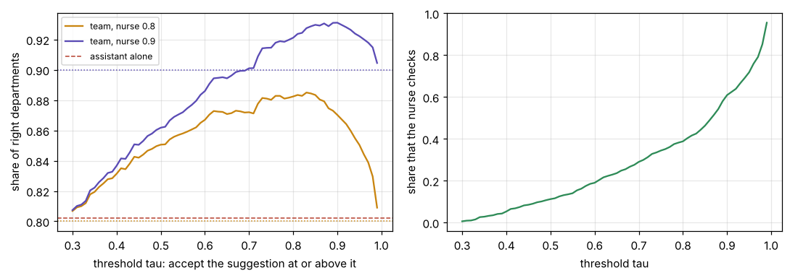
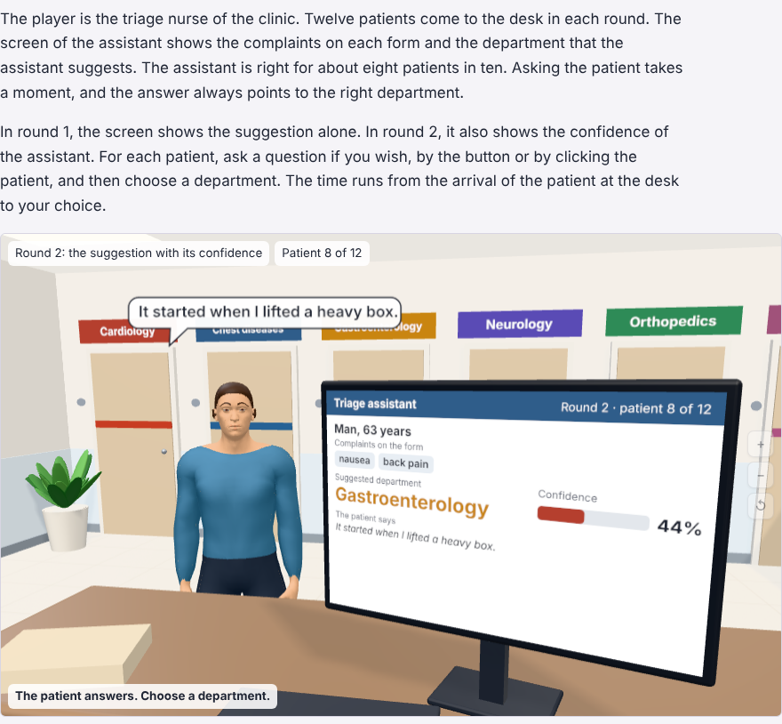

# Week 13: Human-AI Interaction I: Trust, Reliance and Explanations

**Human-Computer Interaction (BIL-429 İnsan-Bilgisayar Etkileşimi)**  
Prof. Dr. Utku Kose, Süleyman Demirel University

   

Reliance that matches how often an assistant is right, a confidence that means what it says, explanations that let people predict the assistant, and trust that follows it over time. Three games in three dimensions (3D) put the player at the triage desk, in the consulting room and beside a delivery robot. **Estimated study time:** 8 to 9 hours.

## Materials of the week

Each material has its own role. Start with the lecture page; the study path below gives the order and the time of each step.

| Material | What it holds | Open |
|---|---|---|
| Lecture page | The concepts of the week, with a 3D scene, two animations, discussion questions, an interface clinic, knowledge checks, review cards and the references | [Lecture page](https://utkukose.github.io/human-computer-interaction-NB-lecture/weeks/week-13/lecture.html) |
| Colab notebook | Python step 13: Probabilities from counts and scores, then six hands-on sections that train the triage assistant and compute the accuracy of a team with a threshold, calibration with the expected calibration error, the Brier score and temperature scaling, contrastive explanations, a model of trust over time and stage 13 of the clinic app, with exercises |  |
| Interactive lab | Human-AI lab: Five parts, among them three 3D games (the triage desk, what the assistant would say and the delivery robot), step-by-step calculators, a self-assessment and an exportable learning log | [Interactive lab](https://utkukose.github.io/human-computer-interaction-NB-lecture/weeks/week-13/lab.html) |
| PDF lecture notes | The Python step and the lecture in one printable file | [PDF notes](Week13_Lecture_Notes.pdf) |

<table><tr><td width="50%"> From the Colab notebook</td><td width="50%"> The interactive lab</td></tr></table>

## Learning outcomes

By the end of the week, students are expected to distinguish trust from reliance and to recognise misuse and disuse of automation. They should be able to compute the accuracy of a team that relies on an assistant of artificial intelligence (AI) above a threshold. They should judge the calibration of a confidence with a reliability diagram, the expected calibration error and the Brier score. They should also explain a suggestion contrastively and predict the effect of a change. Finally, they should be able to model how trust follows the reliability of an assistant over time. In Python, students are expected to turn counts and scores into probabilities.

## Study path

| Step | Activity | Suggested time |
|---|---|---|
| 1 | Read the [lecture page](https://utkukose.github.io/human-computer-interaction-NB-lecture/weeks/week-13/lecture.html), answer its knowledge checks and think through its discussion questions | 1 hour 45 minutes |
| 2 | Run Python step 13: Probabilities from counts and scores in the [Colab notebook](https://colab.research.google.com/github/utkukose/human-computer-interaction-NB-lecture/blob/main/weeks/week-13/NB13_trust_reliance_explanations.ipynb#scrollTo=python-step), right after the setup section | 1 hour |
| 3 | Play the three games of the [interactive lab](https://utkukose.github.io/human-computer-interaction-NB-lecture/weeks/week-13/lab.html), Parts A, C and D, and work through Parts B and E | 1 hour 30 minutes |
| 4 | Work through Sections 1 to 5 of the Colab notebook with your own results and solve the exercises | 2 hours |
| 5 | Use the application switch of Section 6 and solve the application challenge of your field | 45 minutes |
| 6 | Take the self-assessment in the [interactive lab](https://utkukose.github.io/human-computer-interaction-NB-lecture/weeks/week-13/lab.html) (tab: Check yourself) | 20 minutes |
| 7 | Write the reflection in the interactive lab, export the learning log and complete the weekly task below | 45 minutes |

## Live session plan

The week runs as one synchronous session of about three hours in class or online, and each material has one role in it. The lecture page is on the screen. At each orange Colab box, the instructor shows the matching section in a copy of the Colab notebook that has already been run. Students work in their own copy from top to bottom, and each part of the interactive lab follows the part of the lecture that it practises. The PDF lecture notes serve reading after the session, and the study path above serves self-paced study.

| Time | Activity |
|---|---|
| 0:00 to 0:15 | Opening: The clinic app so far and the question of the week, an assistant that suggests a department. Students open the Colab notebook, save a copy in Drive and run Section 0 |
| 0:15 to 0:35 | Colab, together: Python step 13, ending with the softmax of many patients |
| 0:35 to 1:05 | Lecture page, part 1: Trust and reliance with Part A, the 3D scene The plane of trust and capability, the first calculator of Part B and Section 1 |
| 1:05 to 1:25 | Lecture page, part 2: Confidence and calibration with the second calculator of Part B, the animation of calibration and Section 2 |
| 1:25 to 1:35 | Break |
| 1:35 to 2:00 | Lecture page, part 3: Explanations with Part C, the animation of the form and Section 3 |
| 2:00 to 2:30 | Lecture page, part 4: Trust over time with Part D and Section 4 |
| 2:30 to 3:00 | Interface clinic and the human side with their discussion questions, the clinic app, stage 13 with Part E and Section 5, and the closing section on conversational assistants. After the session: Section 6, the self-assessment, the PDF notes and the weekly task |

## Weekly task and submission

**What to do.** First, collect twenty suggestions of an AI tool that you use, for example a spelling checker, a translation tool or a navigation app. Note for each whether it was right and how sure the tool appeared. Second, compute the share right and, where the tool marks some suggestions as certain, the share right in both groups. Finally, choose which suggestions you would check, and estimate the accuracy of you and the tool together.

**Where to look.** Lecture: Sections "Trust and reliance" and "Confidence and calibration". Interactive lab: Parts A, B and E. Colab notebook: Sections 1, 2 and 5, and Exercises A, B and E.

**Example.** A student collects 20 suggestions of a translation tool, of which 16 are right. The tool marks 12 of them as certain, and 11 of these are right, while 5 of the other 8 are. The student is right 0.85 of the time when translating alone. Checking the 8 uncertain suggestions gives 0.6 × 0.917 = 0.550 and 0.4 × 0.85 = 0.340, so the team reaches 0.890, above 0.8 for the tool alone.

**What to submit.** A report of about two pages with the table of the twenty suggestions, the shares right in both groups and the computation of the team. Add the Colab notebook with the exercises of Week 13 completed.

The task is optional and supports self-learning and a personal portfolio. During an active semester, the items listed under What to submit can be sent together with the learning log exported from the interactive lab to utkukose@sdu.edu.tr or utkukose@gmail.com.

## Research and report assignment (optional)

**Explanations and overreliance on AI advice** Do explanations of AI advice help people rely on it appropriately, and which designs reduce overreliance, according to empirical studies?

**What to do.** Select eight empirical studies published since 2018 in which people decided with the advice of an AI, with and without explanations or other interventions. For each study, note the task, the accuracy of the AI and of the people, the explanation or intervention, and its effect on the decisions and on overreliance. Compare the studies, and write recommendations for the explanations of a triage assistant.

**Where to start.** Lecture: Sections "Trust and reliance" and "Explanations: Why this department and not another?". The references of the lecture page give a first entry to the literature.

**Example focus.** A study may compare explanations with a design in which people decide first and then see the advice, as Buçinca and colleagues did. It may report how often people accepted wrong advice in each condition.

The report should be about 1500 words with at least 8 sources, written in the [report template](../../exams/REPORT_TEMPLATE.docx). During an active semester, it can be sent to utkukose@sdu.edu.tr or utkukose@gmail.com.
