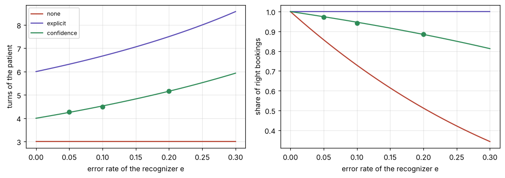
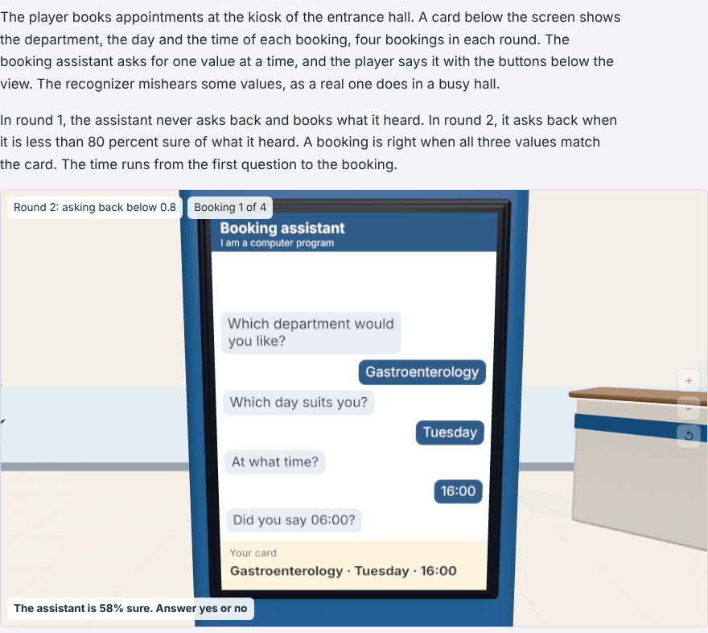

# Week 14: Human-AI Interaction II: Conversational Interfaces, Dark Patterns and Ethics

**Human-Computer Interaction (BIL-429 İnsan-Bilgisayar Etkileşimi)**  
Prof. Dr. Utku Kose, Süleyman Demirel University

   

A booking assistant that talks, asks back when it is unsure and hands over to a person, screens that steer users against their interests, and the values behind design. Three games in three dimensions (3D) put the player at the kiosk, at the tablet of the waiting room and in the control room at night. **Estimated study time:** 8 to 9 hours.

## Materials of the week

Each material has its own role. Start with the lecture page; the study path below gives the order and the time of each step.

| Material | What it holds | Open |
|---|---|---|
| Lecture page | The concepts of the week, with a 3D scene, an animation, discussion questions, an interface clinic, knowledge checks, review cards, a review of the course and the references | [Lecture page](https://utkukose.github.io/human-computer-interaction-NB-lecture/weeks/week-14/lecture.html) |
| Colab notebook | Python step 14: Organised and tested code, then seven hands-on sections that build and test a dialogue manager, compute the turns and the right bookings of asking back, fit a model of user satisfaction, predict the cost of dark patterns, evaluate a handover rule and stage 14 of the clinic app, with exercises |  |
| Interactive lab | Conversations and ethics lab: Five parts, among them three 3D games (the booking assistant, consent and cancellation, and the night supervisor), step-by-step calculators, a self-assessment and an exportable learning log | [Interactive lab](https://utkukose.github.io/human-computer-interaction-NB-lecture/weeks/week-14/lab.html) |
| PDF lecture notes | The Python step and the lecture in one printable file | [PDF notes](Week14_Lecture_Notes.pdf) |

<table><tr><td width="50%"> From the Colab notebook</td><td width="50%"> The interactive lab</td></tr></table>

## Learning outcomes

By the end of the week, students are expected to describe a conversation by turns, intents and slots, and to write a dialogue manager as a tested finite-state machine. They should be able to compute the turns and the right bookings of strategies of asking back. They should explain user satisfaction by task success and the costs of a dialogue. They should also recognise dark patterns and predict their cost, and apply the consent rules of the General Data Protection Regulation of the European Union. Finally, they should be able to evaluate a rule for handing conversations over to a person. In Python, students are expected to organise code into tested functions.

## Study path

| Step | Activity | Suggested time |
|---|---|---|
| 1 | Read the [lecture page](https://utkukose.github.io/human-computer-interaction-NB-lecture/weeks/week-14/lecture.html), answer its knowledge checks and think through its discussion questions | 1 hour 45 minutes |
| 2 | Run Python step 14: Organised and tested code in the [Colab notebook](https://colab.research.google.com/github/utkukose/human-computer-interaction-NB-lecture/blob/main/weeks/week-14/NB14_conversation_dark_patterns_ethics.ipynb#scrollTo=python-step), right after the setup section | 1 hour |
| 3 | Play the three games of the [interactive lab](https://utkukose.github.io/human-computer-interaction-NB-lecture/weeks/week-14/lab.html), Parts A, C and D, and work through Parts B and E | 1 hour 30 minutes |
| 4 | Work through Sections 1 to 6 of the Colab notebook with your own results and solve the exercises | 2 hours |
| 5 | Use the application switch of Section 7 and solve the application challenge of your field | 45 minutes |
| 6 | Take the self-assessment in the [interactive lab](https://utkukose.github.io/human-computer-interaction-NB-lecture/weeks/week-14/lab.html) (tab: Check yourself) | 20 minutes |
| 7 | Write the reflection in the interactive lab, export the learning log and complete the weekly task below | 45 minutes |

## Live session plan

The week runs as one synchronous session of about three hours in class or online, and each material has one role in it. The lecture page is on the screen. At each orange Colab box, the instructor shows the matching section in a copy of the Colab notebook that has already been run. Students work in their own copy from top to bottom, and each part of the interactive lab follows the part of the lecture that it practises. The PDF lecture notes serve reading after the session, and the study path above serves self-paced study.

| Time | Activity |
|---|---|
| 0:00 to 0:15 | Opening: The clinic app so far and the question of the week, an assistant that talks. Students open the Colab notebook, save a copy in Drive and run Section 0 |
| 0:15 to 0:35 | Colab, together: Python step 14, ending with the small test runner |
| 0:35 to 1:05 | Lecture page, part 1: Conversational interfaces with the 3D scene A conversation as a state machine, Part A and Section 1, then errors and confirmations with Part B, the animation and Section 2 |
| 1:05 to 1:25 | Lecture page, part 2: Evaluating conversations with Section 3 |
| 1:25 to 1:35 | Break |
| 1:35 to 2:05 | Lecture page, part 3: Dark patterns with Part C and Section 4, then privacy and consent |
| 2:05 to 2:30 | Lecture page, part 4: Handing over to a person with Part D and Section 5, and the ethics of design |
| 2:30 to 3:00 | Interface clinic and the human side with their discussion questions, the clinic app, stage 14 with Part E and Section 6, and the review of the course. After the session: Section 7, the self-assessment, the PDF notes and the weekly task |

## Weekly task and submission

**What to do.** First, book an appointment, a table or a ticket with a chatbot or a voice assistant. Count the turns, the errors and the questions that it asked back. Second, cancel a subscription or refuse the cookies of a website, and count its taps and the dark patterns that you meet. Finally, predict both times with the keystroke-level model and propose a fair design.

**Where to look.** Lecture: Sections "Errors and confirmations" and "Dark patterns". Interactive lab: Parts A, C and E. Colab notebook: Sections 2 and 4, and Exercises B and D.

**Example.** A student books a table with a chatbot in 7 turns, one value of which the chatbot asked back. Refusing the cookies of a news site takes 6 taps, 6 × 2.65 = 15.9 s, against 2.65 s for accepting all. The student redesigns the banner with two equal buttons.

**What to submit.** A report of about two pages with the counts of both tasks, the predicted times and the redesign. Add the Colab notebook with the exercises of Week 14 completed.

The task is optional and supports self-learning and a personal portfolio. During an active semester, the items listed under What to submit can be sent together with the learning log exported from the interactive lab to utkukose@sdu.edu.tr or utkukose@gmail.com.

## Research and report assignment (optional)

**Dark patterns in health and public services** Which dark patterns occur in health and public services, how do they affect users, and which designs or rules counter them?

**What to do.** Select eight empirical studies published since 2018 on dark patterns, consent or cancellation flows. For each study, note the services, the method, the dark patterns found and their effect on users. Compare the studies, and write recommendations for the consent and cancellation screens of a clinic app.

**Where to start.** Lecture: Sections "Dark patterns" and "Privacy and consent". The references of the lecture page give a first entry to the literature.

**Example focus.** A study may scrape consent screens, as Nouwens and colleagues did, and test their designs in an experiment.

The report should be about 1500 words with at least 8 sources, written in the [report template](../../exams/REPORT_TEMPLATE.docx). During an active semester, it can be sent to utkukose@sdu.edu.tr or utkukose@gmail.com.
